# 2026机场推荐：专线、月付与按量套餐对比及选购指南

选机场先确认客户端路线，再比较实付周期与流量。日常使用可从预算表选档，间歇使用重点看总量包有效期；专线、中转和标称带宽则要落实到所选套餐与节点。已有服务的人可直接进入客户端教程或故障处理，无需重新开始购买。

每天用机场，可以从[预算和用途表](#airport-budget)对照月费、流量和客户端。只在出差或旅行时用，先看[按量包和周期套餐的区别](#airport-payg)，尤其留意剩余流量能保留多久。

收录40家机场，完整品牌目录可展开查看；套餐横向表与选购指南分别回答价格、付款、流量和客户端问题。想比较服务商App、套餐与设备支持，见[多家VPN推荐与推广](https://github.com/John19187/The-40-Best-VPNs#翻墙客户端与使用方式怎么选)。已有服务的人可从[客户端选择](#airport-clients)进入本款教程，连接失败则先看[本帖的故障判断](#机场连不上了先分清是哪一种)。

[全部品牌资料](#稳定性价比机场) · [按预算和用途选机场](#airport-budget) · [套餐横向比较](#airport-comparison) · [月付与按量怎么选](#airport-payment) · [客户端选择](#airport-clients) · [购买常见问题](#airport-faq)

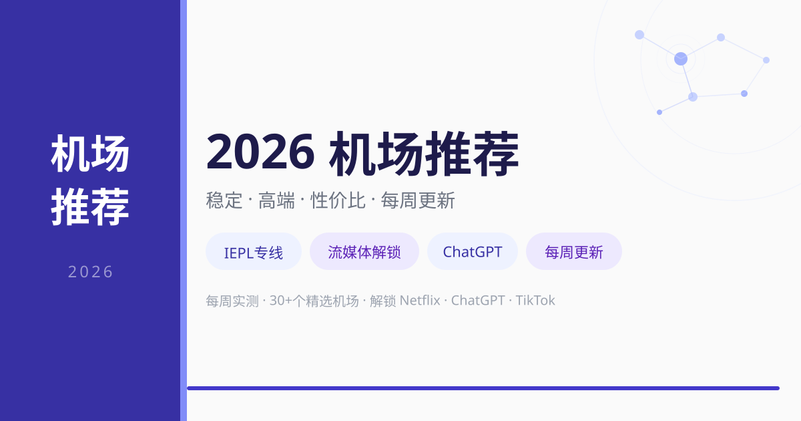

<b>目录：全部 40 家机场 · 点击展开</b>

[稳定性价比机场](#稳定性价比机场) · [WgetCloud机场](#wgetcloud机场) · [杨帆云机场](#杨帆云机场) · [老猫云机场](#老猫云机场) · [Taishan Net 泰山机场](#taishan-net-泰山机场) · [大哥云机场](#大哥云机场) · [桔子云机场](#桔子云机场) · [优信云机场](#优信云机场) · [FSCloud机场](#fscloud机场) · [flowercloud花云机场](#flowercloud花云机场) · [隐云机场](#隐云机场) · [百变小樱机场](#百变小樱机场) · [蚯蚓机场](#蚯蚓机场) · [可乐云机场](#可乐云机场) · [GsouCloud机场](#gsoucloud机场) · [ByWave机场](#bywave机场) · [奶茶Cloud机场](#奶茶cloud机场) · [万城Vcity机场](#万城vcity机场) · [泡芙云机场](#泡芙云机场) · [Web3加速器](#web3加速器) · [飞机云机场](#飞机云机场) · [灯塔Cloud机场](#灯塔cloud机场) · [奈云机场](#奈云机场) · [网际快车 (Flash Express)](#网际快车-flash-express) · [霓虹](#霓虹) · [虫洞云机场](#虫洞云机场) · [小旋风机场](#小旋风机场) · [一云梯机场](#一云梯机场) · [Gatern机场](#gatern机场) · [速鹰666机场](#速鹰666机场) · [一枝红杏机场](#一枝红杏机场) · [BoostNet机场](#boostnet机场) · [悠兔机场](#悠兔机场) · [掌中世界机场](#掌中世界机场) · [WestData西部数据机场](#westdata西部数据机场) · [速云梯机场](#速云梯机场) · [MESL机场](#mesl机场) · [Bitz Net机场](#bitz-net机场) · [蓝帆云](#lanfanyun) · [秒连云机场](#miaolianyun)

[按预算和用途选机场](#airport-budget) · [按月付、季付与按量需求比较机场](#按月付季付与按量需求比较机场) · [客户端选择](#airport-clients) · [购买常见问题](#airport-faq) · [机场连不上了，先分清是哪一种](#机场连不上了先分清是哪一种) · [更新日志](#更新日志)

### 购买前，把费用、使用方式和线路条件一起看

本文是多家机场服务的推荐与推广文章，注册入口含推广链接。各家的套餐价格、付款周期和使用条件，见对应品牌段落。

先看自己的设备能否使用本家App或兼容订阅，再比较一次付款总额、流量重置和设备／IP限制。年付按全年总价支付；按量包还要确认有效期和节点倍率。需要试用或退款时，按该服务明确列出的条件处理。

有隐私、单位网络或特定地区要求，查看对应政策和适用范围。选择时结合所选套餐、使用地区和客户端条件；横向表帮助比较，品牌章节提供具体套餐、图片和注册入口。

**没有任何一家机场或VPN能够一直稳定。** 日常使用时，要对偶尔断联有所预期。2026年4月以来，大陆跨境网络环境经历了多轮收紧。10月下旬[重要会议](https://www.news.cn/politics/leaders/20260921/6d2f7db5a4c1477bb588a75e1ad87a4b/c.html)前后，部分直连和海外中转线路又出现端口受阻、节点超时等情况。进入11月，已有用户反馈连接情况明显改善。

GFW会识别并干扰部分代理流量，节点入口的IP或端口可能因此被封锁。采用AWS入口自动换IP机制的机场或VPN，会监测入口是否可用，发现IP或端口受阻后自动切换入口IP。检测和切换需要时间，期间可能断联几分钟，有时约10分钟。

线路调整和恢复的前后记录见[网络环境与历史变化](https://github.com/John19187/ssr-v2ray-trojan-clash-guide#network-context)，技术背景可看GFW的[公开研究](https://gfw.report/publications/usenixsecurity23/en/)。

在学校使用时，优先用自己的手机流量，或自己办理、直接连接运营商网络的流量卡；电脑可以连接手机热点。按本校规定使用校园网，个人连接与校内网络分开安排即可。具体说明见[校园网与个人流量怎么选](https://github.com/John19187/ssr-v2ray-trojan-clash-guide#campus-use)。

平时多留意你购买的机场服务商的首页公告。节点域名更换、端口受阻或线路调整时，按说明更新订阅、切换节点或调整客户端，减少旧配置造成的断联。服务改用专属App前，确认自己的设备仍受支持。订阅链接包含个人令牌，保存在自己的客户端中，反馈故障时遮盖订阅、账号和日志中的身份信息。

跨境使用频繁的人，可以按实际成本保留另一条备用连接或少量备用流量，并提前确认客户端能打开、套餐有流量、常用目标能访问。原来可用的多个节点同时失败时，先核对账户有效期、剩余流量和你所用服务商的首页公告，再用同一节点比较自己的Wi-Fi与移动网络。是否购买备用、买多少，按工作依赖、已有服务和使用频率决定。

本帖也收录了便宜的入门套餐，方便对照不同预算与使用条件，选购时一起比较价格与服务条件。**不建议购买价格低得异常、运营与退款条件又说不清的超低价机场。** 带宽、服务器、线路维护和客服都需要持续投入，如果没有相应维护和实际交付能力，标出的流量也不一定能按约使用。可能遇到高峰拥挤、限制增加、维护跟不上、频繁迁移，甚至停运或收款后失联；预付周期越长，尚未消费的款项也越多。选购时比较运营记录、实际可用性和明确的试用／退款条款，不只比较月均价，更不要为折扣一次压上很长周期。

## 按预算和用途选机场

| 你的需求 | 优先比较 | 选择时抓住什么 |
|---|---|---|
| 希望直接使用官方客户端 | [稳定机场](#稳定性价比机场) | 月付100/300/500GB分别¥18/38/53.60；只支持官方专属客户端，不提供Clash或[小火箭](https://github.com/John19187/proxy-client-guides/blob/main/downloads/shadowrocket/README.md#import)等第三方订阅 |
| 已有第三方客户端，想按专线档位选择 | [WgetCloud](#wgetcloud机场) | 新购按季付与年付比较，基础、优质、精品的每30天流量和可用IP数不同；可用IP与设备数分别核对 |
| 预算较低，想按月使用 | [泰山](#taishan-net-泰山机场) | 128GB档月付¥13；64GB档从季付¥29起，月均约¥9.67，下单付¥29 |
| 偶尔使用或准备备用流量 | [泰山总量包](#taishan-net-泰山机场)、[按量选择方法](#airport-payg) | 200GB/¥78、600GB/¥195是总量包，不每月重发；有效期、节点倍率和到期处理按所选套餐核对 |
| 需要按客户端和节点等级选档 | [杨帆云](#杨帆云机场) | LV1月付¥19.99、100GB、2台设备；按UniClash路线与所选等级的节点范围比较 |

稳定机场适合接受本家客户端路线的用户，WgetCloud侧重套餐等级与第三方订阅选择，泰山可比较周期配额与按量总量，杨帆云按UniClash路线及套餐等级选择。价格按对应段落的资料日期比较，实际可购项以商店为准；线路标称不能替代你所在网络的使用体验。

## Clash、小火箭订阅与官方客户端怎么选

已有Clash系列或[Shadowrocket](https://github.com/John19187/proxy-client-guides/blob/main/downloads/shadowrocket/README.md#import)（小火箭）的配置时，优先确认服务商提供对应的订阅格式。支持Trojan、Shadowsocks或Vmess，是协议层面的条件；能否直接导入，还取决于本家订阅输出和客户端版本。

已经拿到订阅，还没决定电脑、手机或路由器该装哪款，可以对照[2026年机场通用客户端汇总与下载教程](https://github.com/John19187/proxy-client-guides#choose)。准备在电脑或 Android 上用 [FlClash](https://github.com/John19187/proxy-client-guides/blob/main/downloads/flclash/README.md#import)，可直接看[FlClash 安装包选择、导入订阅与连接图解](https://github.com/John19187/proxy-client-guides/blob/main/downloads/flclash/README.md#packages)。手里只有旧版 Clash 教程的，可直接看[旧版识别与迁移步骤](https://github.com/John19187/proxy-client-guides/blob/main/downloads/legacy/README.md#migration)。

| 使用路线 | 可从哪些品牌说明开始看 | 注册前确认什么 |
|---|---|---|
| 官方专属客户端 | [稳定机场](#稳定性价比机场)、[杨帆云](#杨帆云机场) | 稳定机场仅官方客户端，不提供第三方订阅；杨帆云按原说明使用UniClash，先确认自己的系统可安装 |
| 第三方客户端订阅 | [WgetCloud](#wgetcloud机场)、[泰山](#taishan-net-泰山机场) | 读取本家对应系统的教程，选择该客户端的订阅格式，按本人的账户教程处理 |

[Windows与macOS](https://github.com/John19187/proxy-client-guides#desktop)、[Android](https://github.com/John19187/proxy-client-guides#android)、[iPhone与iPad](https://github.com/John19187/proxy-client-guides#ios)的安装来源与导入方式各不相同。按客户端完整名称与发布项目选择；按本家教程核对下载入口、订阅格式与系统权限。需要进一步理解协议和订阅的区别，可看[机场、协议与订阅科普](https://github.com/John19187/ssr-v2ray-trojan-clash-guide#subscription)。

具体软件按对应格式直达教程：Windows／Mac用[Rev导入订阅](https://github.com/John19187/proxy-client-guides/blob/main/downloads/clash-verge-rev/README.md#import)或[v2rayN订阅分组](https://github.com/John19187/proxy-client-guides/blob/main/downloads/v2rayn/README.md#import)，Android用[CMFA完整配置](https://github.com/John19187/proxy-client-guides/blob/main/downloads/cmfa/README.md#import)或[v2rayNG节点订阅](https://github.com/John19187/proxy-client-guides/blob/main/downloads/v2rayng/README.md#import)，iPhone可看[Shadowrocket](https://github.com/John19187/proxy-client-guides/blob/main/downloads/shadowrocket/README.md#import)、[Stash](https://github.com/John19187/proxy-client-guides/blob/main/downloads/stash/README.md#import)或[Loon](https://github.com/John19187/proxy-client-guides/blob/main/downloads/loon/README.md#import)。路由器对应[OpenClash完整配置](https://github.com/John19187/proxy-client-guides/blob/main/downloads/openclash/README.md#import)与[PassWall节点订阅](https://github.com/John19187/proxy-client-guides/blob/main/downloads/passwall/README.md#import)，前提都是本家明确支持。

订阅地址包含个人账户信息，导入自己的客户端即可，不要发到公开群、截图或评论区。稳定机场用户直接走官方客户端路线，不需要寻找第三方转换链接。

## 稳定性价比机场

### 稳定机场套餐补充（资料日期：2026-11-05）

三档月付为轻量¥18/100GB/3台客户端、专业¥38/300GB/15台、高级¥53.60/500GB/20台。年付¥76、¥116、¥146、¥176、¥226分别每月重置50GB、100GB、150GB、200GB、300GB，客户端同时登录数分别为3、10、13、20、30台。

稳定机场即星云，提供月付、年付和一次性总量包。选购先看自己的月用量、同时登录客户端数，再比较一次支付金额。

👉 **[稳定机场官网注册入口](https://so.dianlanla.com/xingyun2)**

[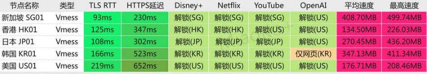](assets/review-images/3a471828d5564921-original.png)

### 以下是该平台的几大亮点：

- **视频与流媒体支持**  
支持ChatGPT、YouTube、Netflix等平台。

- **AI与开发工具**
高速访问ChatGPT、Gemini、Claude、Midjourney、Perplexity；Cursor、Codex、Google Antigravity等生产力平台

- **专线跨境服务**  
  采用企业级专线构建跨境网络，可结合常用地区、晚高峰体验及本家维护情况选择适合的档位。

- **全球节点布局**  
  服务网络覆盖香港、台湾、日本、韩国、新加坡、泰国、马来西亚、美国、德国、英国、法国、意大利、西班牙、澳大利亚、加拿大、荷兰、瑞典、俄罗斯、哥伦比亚、南非、印度、巴西、墨西哥、印尼、瑞士等50个边缘区域，需要特定出口地区时，先查看所选套餐实际开放的节点。

- **客服渠道**  
  提供24小时在线客服入口，可咨询套餐、客户端与线路问题。

- **高性价比优势**  
  月付、年付和一次性流量可按预算与实际用量分别比较。

- **线路维护与日常连接**  
  适合需要日常连接的用途，选购时可重点关注入口维护、故障恢复与自己网络下的使用表现。

- **续费与现有权益**  
  续费前可核对当前套餐、客户端数量与常用线路是否仍满足需求。

- **隐私与使用条件**  
  有科研、外贸或其他保密需求时，另行核对日志政策、客户端与单位使用要求；不能用专线或加密名称代替隐私审查。

- **专属自研客户端**  
  需要安装本家App并用自己的账户登录。目前仅支持官方专属客户端，不再提供用于Clash、[Shadowrocket](https://github.com/John19187/proxy-client-guides/blob/main/downloads/shadowrocket/README.md#import)等第三方客户端的订阅链接。安装前可对照[专属App与第三方订阅的区别](https://github.com/John19187/proxy-client-guides#client-compatibility)，具体软件仍从本家教程获取。

### 月付套餐

| **套餐类型** | **价格** | **月流量** | **同时登录客户端数** | **标称带宽** |
| ------------ | -------- | ---------- | ------------ | -------- |
| 轻量版       | ¥18.00   | 100GB      | 3            | 800Mbps  |
| 专业版       | ¥38.00   | 300GB      | 15           | 3000Mbps |
| 高级版       | ¥53.60   | 500GB      | 20           | 5000Mbps |

### 年付套餐

年付套餐的流量按月配额比较，下表为各月额度的一年合计；例如¥76档每月50GB、¥116档每月100GB、¥146档每月150GB，不是一次性总量包。

| **套餐类型**   | **价格** | **月配额的一年合计** | **同时登录客户端数** | **标称带宽** |
| -------------- | -------- | ---------- | ------------ | -------- |
| 特惠限量版     | ¥76.00   | 600GB      | 3            | 3000Mbps |
| 特惠限量Air    | ¥116.00  | 1200GB     | 10           | 3000Mbps |
| 特惠限量Plus   | ¥146.00  | 1800GB     | 13           | 5000Mbps |
| 特惠限量Pro    | ¥176.00  | 2400GB     | 20           | 5000Mbps |
| 特惠限量Ultra  | ¥226.00  | 3600GB     | 30           | 5000Mbps |

📟 **不限时流量包：¥48/200GB、¥109/500GB、¥279/1500GB、¥499/3200GB。** 较大两档的流量口径仍需向客服确认；不限时总量与年付每月重置配额分开比较。

### 优惠码与适用套餐

以下优惠信息截至2026年11月5日。选择套餐和付款周期后，在结算页输入对应优惠码；上表列套餐原价，具体折扣看该订单的结算结果。

| 优惠码 | 折扣 | 适用范围 |
|---|---|---|
| `星云` | 95折 | 公告标明限月付、年付 |
| `xingyun88` | 88折 | 1年付 |
| `xingyun75` | 75折 | 公告标明两年付 |
| `xingyun77` | 77折 | 特惠限量年付系列的套餐说明列为两年付优惠 |
| `xingyun89` | 89折 | 公告标明老套餐 |
| `9999` | 未列明确折扣 | 黄金一次性流量包专属码，优惠金额看结算页验证结果 |

两年付优惠码有`xingyun75`和`xingyun77`两种，适用档位需要在所选套餐的结算页确认。活动截止日和叠加规则未明，按该订单显示的折后总价付款。

**套餐选购建议**

按流量和设备数分别选择，二者都要覆盖自己的用量：

1. **轻度使用者**  
   主要用于网页浏览、简单互动（如使用ChatGPT）的用户，建议选择轻量版月付或参与限时优惠的年付套餐，满足基础需求的同时实现成本控制。

2. **中度使用者**  
   经常观看视频及流媒体服务的用户，先按月用量对照专业版月付¥38/300GB与年付¥226、每月300GB的档位；同时比较设备上限和首次付款，不把折扣当作速度保证。

3. **重度使用者**  
   多终端同时在线、视频用量较高时，可比较高级版月付¥53.60/500GB/20台与年付档的流量、设备数量；两项限制分别核对，选择能覆盖实际需求的组合。

> **套餐选择**：月付按每月额度比较，年付按全年应付金额和各月额度比较；一次性流量包按总量及有效期比较。客户端数与标称速率按所选档位，第三方订阅用户需选择其他支持通用订阅的服务。

文中部分链接可能帮助承担服务器、域名等维护成本，推荐依据不因此改变。

------
## WgetCloud机场

WgetCloud（原 GaCloud）主打多线BGP中转与双程CN2线路，在香港设有机房，套餐分基础、优质与精品三档。选择时可以把常用地区、流量、可用IP数与套餐等级一起比较。

WgetCloud 机场使用的早期支持 Shadowsocks 、SSR、V2ray（vmess）、Trojan协议，自 2023 年末开始仅开放 Trojan 协议的订阅格式支持，兼容目前几乎主流的订阅软件。已经复制本人订阅时，可按[Clash Verge Rev导入与选节点](https://github.com/John19187/proxy-client-guides/blob/main/downloads/clash-verge-rev/README.md#import)或[Shadowrocket导入步骤](https://github.com/John19187/proxy-client-guides/blob/main/downloads/shadowrocket/README.md#import)操作。

👉 **[WgetCloud机场官网注册入口](https://so.dianlanla.com/wgetcloud)**

[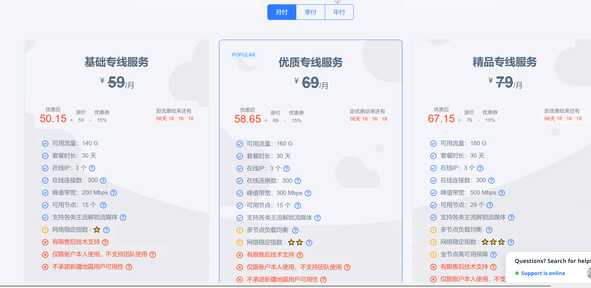](assets/review-images/ed3e875eade9440b-original.png)

### 📊 **WgetCloud 套餐价格对比表**

新购个人套餐按季付、年付选型。官方帮助中心列出的月流量与可用IP数如下；应付金额见个人套餐商店，可用IP与同时在线设备数分别核对。

| 等级 | 季付：每30天流量 | 年付：每30天流量 | 可用IP数 | 标称限速 |
|---|---:|---:|---:|---:|
| 基础 | 230G | 280G | 3 | 200Mbps |
| 优质 | 250G | 320G | 4 | 300Mbps |
| 精品 | 270G | 360G | 5 | 500Mbps |

WgetCloud官方套餐说明按新购与既有订单区分权益；既有订单以订单中心为准。下表保留过往付款与流量规格，方便旧用户对照，新的购买选择按上表及商店可购项判断。

| 套餐等级     | 月付 | 流量/月 | 季付 | 流量/月 | 年付 | 流量/月 |
| ------------ | ---- | ------- | ---- | ------- | ---- | ------- |
| **基础专线** | ¥59  | 140GB   | ¥162 | 200GB   | ¥588 | 240GB   |
| **优质专线** | ¥69  | 160GB   | ¥195 | 220GB   | ¥708 | 280GB   |
| **精品专线** | ¥79  | 180GB   | ¥228 | 240GB   | ¥828 | 320GB   |

---

**🎯 套餐选择建议**

| 人群                       | 推荐套餐                 | 理由                             |
| -------------------------- | ------------------------ | -------------------------------- |
| 常用港、台、新、日、美节点 | **基础、优质或精品** | 先按月用量和可用IP数匹配档位 |
| 需要额外地区或更高标称限速 | **精品** | 看额外节点是否包含所需地区，地区节点与服务可用性分开判断 |
| 同一档位比较季付与年付 | **对应周期** | 比较首次应付总额及每30天配额，而不是只算月均费用 |
| 新用户 | **商店当前可购项** | 不提供免费试用；折扣按结算页可用条件，不套用旧首购折扣 |

------
## 杨帆云机场

2025 年才上线的杨帆云，走的是 IEPL 隧道叠 BGP 中转的双层线路，账号能连到哪些节点直接跟套餐档位挂钩——低档位只开放国内中转，往上加钱才逐级解锁香港、台湾、日本、新加坡、美国的专线池，LV4 和旗舰版才能拿到全 IEPL。各档不仅流量不同，可用线路也不同；先找到包含所需地区的等级，再比较费用。

- 节点使用VMess协议，官方要求走自研客户端 UniClash，第三方 [Clash Verge](https://github.com/John19187/proxy-client-guides/blob/main/downloads/old-clash-verge/README.md#migration)、[Shadowrocket](https://github.com/John19187/proxy-client-guides/blob/main/downloads/shadowrocket/README.md#import) 在新版加密下连不稳，认准自家客户端再下单。
- 最高标称带宽2000Mbps，对应LV4与旗舰版；不把标称上限当作实际下载速度。
- 流媒体和ChatGPT访问取决于实际节点；各等级开放的中转与专线范围，按下表分别选择。

👉 **[杨帆云机场官网注册入口](https://so.dianlanla.com/yangfan)**

[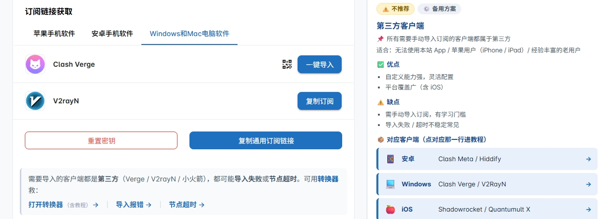](assets/review-images/9c4413f5ff9747ba-original.jpg)

### 套餐一览

| 档位 | 月费 | 月流量 | 设备数 | 峰值速度 | 可用线路 |
|---|---|---|---|---|---|
| LV1 | ¥19.99 | 100GB | 2台 | 200Mbps | 仅等级一（国内中转） |
| LV2 | ¥29.99 | 200GB | 3台 | 500Mbps | 等级一、二 |
| LV3 | ¥39.99 | 400GB | 4台 | 1000Mbps | 等级一、二、三（部分 IEPL） |
| LV4 | ¥49.99 | 700GB | 6台 | 2000Mbps | 全等级（全 IEPL） |
| 旗舰版 | ¥88.99 | 1200GB | 6台 | 2000Mbps | 全等级（含 IEPL） |

档位怎么选：每月用量在100GB内，可从LV1看起；需要部分IEPL节点时比较LV3，需要全部IEPL范围时再比较LV4和旗舰版。月用量超过700GB时还要看旗舰版配额。4K、游戏或视频会议的效果，需在所需节点和自己的网络上判断，不按价格直接推定。第三方客户端连不上不算售后问题，下单前先确认能接受用 UniClash。

------
## 老猫云机场

老猫云是一家成立于2017年的老牌机场，主要提供IEPL专线服务，使用Trojan协议，入口位于深圳移动。套餐按月流量分档，另列1小时免费试用。

**特点**
IEPL专线：标称最高速率1000Mbps，服务可用率承诺99%（SLA）；保障范围与补偿按本家服务条款。

Trojan协议：使用TLS传输，导入时选择本家提供的兼容格式。

流媒体与AI支持：Netflix、Disney+、TikTok及ChatGPT。

免费试用：提供1小时的免费试用，方便用户测试服务质量。

客户端支持：有官网的Windows、Android、Mac客户端，新手友好。

节点分布：节点分布在香港、日本、新加坡、美国、台湾、英国、俄罗斯等地区。

👉 **[老猫云机场官网注册入口](https://so.dianlanla.com/laomao)**

[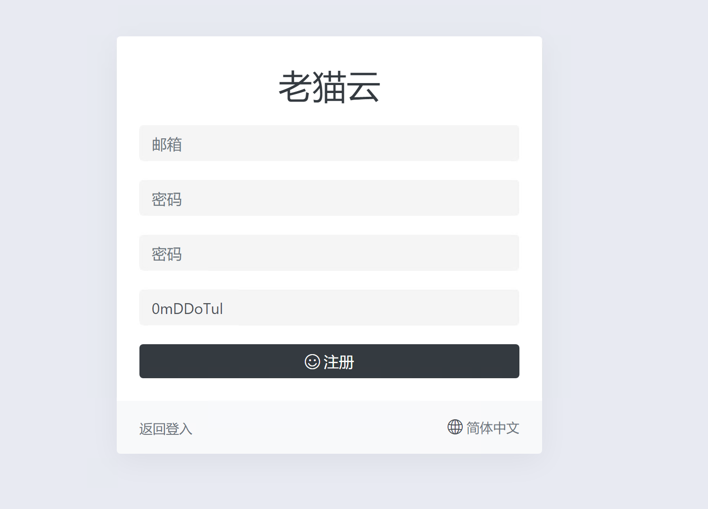](assets/review-images/88fc61706dfdfc57-original.png)

### 套餐表格  

| 套餐      | 价格    | 计费方式 | 每月流量 | 退款政策      | 速率上限 | 其他特点                                                     |
| --------- | ------- | -------- | -------- | ------------- | -------- | ------------------------------------------------------------ |
| **B套餐** | ¥45.00  | 季付     | 50G      | 原资料7天，按当前条款确认 | 100Mbps  | IEPL专线，支持Netflix/TVB/Hulu与UDP转发 |
| **C套餐** | ¥20.00  | 月付     | 100G     | 原资料3天，按当前条款确认 | 200Mbps  | IEPL专线，支持Netflix/TVB/Hulu与UDP转发 |
| **D套餐** | ¥30.00  | 月付     | 200G     | 原资料3天，按当前条款确认 | 300Mbps  | IEPL专线，支持Netflix/TVB/Hulu与UDP转发 |
| **E套餐** | ¥40.00  | 月付     | 300G     | 原资料7天，按当前条款确认 | 400Mbps  | IEPL专线，支持Netflix/TVB/Hulu与UDP转发 |
| **F套餐** | ¥150.00 | 季付     | 500G     | 原资料7天，按当前条款确认 | 500Mbps  | IEPL专线，支持Netflix/TVB/Hulu与UDP转发 |

------
## Taishan Net 泰山机场

### 泰山最低实付与周期补充（资料日期：2026-09-07）

| 配额 | 月付 | 季付 | 半年付 | 年付 |
|---|---:|---:|---:|---:|
| 每月64GB | 无 | ¥29 | ¥50 | ¥88 |
| 每月128GB | ¥13 | ¥35 | ¥65 | ¥110 |
| 每月256GB | ¥24 | ¥63 | ¥117 | ¥195 |
| 每月512GB | ¥42 | ¥112 | ¥208 | ¥350 |

按量包另为总量200GB/¥78、600GB/¥195。64GB档最低付¥29买一季，折算月均约¥9.67；页面说明无退款政策。下方旧表与原图保留作历史对照，购买前再核当前结算金额。

Taishan Net（泰山机场）是一家由海外团队运营的机场服务，成立于2023年5月。它提供月度配额和按量总量包两种选择：64GB档从季付¥29起，128GB档可月付¥13，其他周期见上表。流媒体、ChatGPT等用途还需对应所选节点和地区。

**主要特点**：
节点分布：拥有40+节点，涵盖美国、香港、台湾、日本、新加坡、德国、英国等地区。

线路类型：提供中转和IPLC专线，IPLC线路具有5倍流量倍率。

付款方式：支持支付宝、微信和USDT付款。

客户端支持：兼容[Clash for Windows](https://github.com/John19187/proxy-client-guides/blob/main/downloads/cfw/README.md#migration)、[Clash for Android](https://github.com/John19187/proxy-client-guides/blob/main/downloads/cfa/README.md#migration)、[Shadowrocket](https://github.com/John19187/proxy-client-guides/blob/main/downloads/shadowrocket/README.md#import)等客户端。旧教程中的软件名称和下载包，按[旧版识别与迁移步骤](https://github.com/John19187/proxy-client-guides/blob/main/downloads/legacy/README.md#migration)核对，不沿用历史包下载入口。

服务特点：不限速，不限制同时在线设备数，0日志政策。

128GB档可按月购买，64GB档从季付起购；预算比较时把首次付款与每月额度分开看。需要帮助时，可通过泰山站内工单与官方群组联系支持。

👉 **[泰山机场官网注册入口](https://so.dianlanla.com/taishan)**

[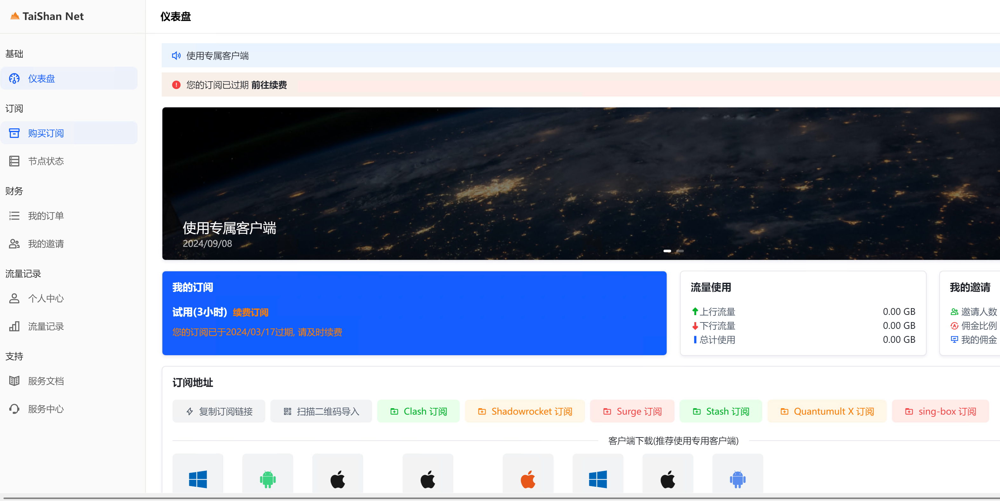](assets/review-images/04c1aba73ed67299-original.png)

### **月付与季付起购套餐**

| 套餐名称 | 首次付款 | 每月流量 | 年付总价 | 比较条件 |
| -------- | --------- | -------- | -------- | ----------------------------------------- |
| 64G流量  | ¥29/季，无月付 | 64GB/月 | ¥88/年 | 节点、倍率与客户端见对应档位 |
| 128G流量 | ¥13/月 | 128GB/月 | ¥110/年 | 同上 |
| 256G流量 | ¥24/月 | 256GB/月 | ¥195/年 | 同上 |
| 512G流量 | ¥42/月 | 512GB/月 | ¥350/年 | 同上 |

### **不限时流量套餐（过往规格对照）**

9月7日套餐资料中的总量包为200GB/¥78、600GB/¥195，不按月重发流量；下方原规格与原图保留供旧订单对照，新的总量包选择以上方套餐记录和商店为准。

| 套餐名称    | 价格       | 流量   | 特点                                      |
| ----------- | ---------- | ------ | ----------------------------------------- |
| 150G不限时  | ¥27.00/次  | 150GB  | 不限设备、不限速、流媒体解锁、SecureX加密 |
| 500G不限时  | ¥65.00/次  | 500GB  | 同上                                      |
| 1000G不限时 | ¥120.00/次 | 1000GB | 同上                                      |

### **特点**

- **不限制设备连接数量**：设备数量不另设上限；多人共享或商用仍看本家条款。
- **不限速**：套餐不设固定速率上限，实际速度由节点和当前网络共同决定。
- **流媒体解锁**：支持解锁Netflix、HBO、Disney+等流媒体。
- **SecureX安全隧道加密协议**：站方介绍其加密隧道功能；隐私保护仍需结合客户端、账号和日志政策判断。
- **国内三线骨干网入口**：提供不同运营商入口，按自己的网络选择。
- **负载均衡技术**：优化网络性能。
- **支持渠道**：站内工单与本家群组，具体入口从已保存的官网查看。

------

------
## 大哥云机场

### 大哥云套餐补充（资料日期：2026-09-07）

| 档位 | 实际付款 | 流量口径 |
|---|---:|---|
| 单月A | ¥19.90/月 | 每月100GB |
| 单月B | ¥29.00/月 | 每月150GB |
| 季付A | ¥69/季 | 每月200GB |
| 年付A | ¥199/年 | 每月300GB |
| 年付B | ¥299/年 | 每月500GB |
| 小流量年付 | ¥88/年 | 每月15GB |

旧150GB月付¥29.90按该记录更正为¥29.00；旧年付1000GB档不在这份六档目录中。说明写新疆地区不可用、不支持原路退款，部分套餐按订单日重置。原表与配图保留，套餐区别以日期明确的新记录作参照。

大哥云机场是一家成立于2020年的VPN梯子机场，提供Trojan节点和多地区线路。该机场使用Trojan协议，支持V2Ray订阅链接一键订阅，适用于Android、iOS、macOS、路由器、Windows等多种平台。准备在路由器导入时，先按[OpenWrt客户端与固件检查](https://github.com/John19187/proxy-client-guides#router)确认设备条件，再用本家对应配置。

特点
- **节点分布**：覆盖台湾、新加坡、日本、泰国、美国、英国、菲律宾、越南、韩国、香港等国家和地区
- **流媒体解锁**：支持解锁Netflix、Disney+、TikTok等流媒体服务
- **不限设备数量**：支持多设备同时在线使用
- **客户端路线**：提供Windows、macOS、iOS、Android等教程；其中Nextin为公共客户端，不都属于本家自研App
- **付款方式**：支持支付宝和微信支付

2026年11月，大哥云300GB与500GB年付套餐提供9折码`mcuE8uOq`。结算时输入优惠码，确认折后金额再付款。

👉 **[大哥云机场官网注册入口](https://so.dianlanla.com/dageyun)**

###  套餐详情介绍

| 套餐 | 价格 | 时长 | 每月流量 | 最大带宽 | 其他特点 |
|------|------|------|---------|---------|---------|
| **VIP1 小流量年付**  | ¥88.00 | 1年 | 15GB | 500 Mbps | 新疆不可用，不支持退款 |
| **年付套餐A** | ¥199.00 | 1年 | 300GB | 1000 Mbps | 新疆不可用，优惠适用性见本节说明 |
| **年付套餐B** | ¥299.00 | 1年 | 500GB | 1000 Mbps | 新疆不可用，优惠适用性见本节说明 |
| **年付套餐 1000GB** | ¥699.00 | 1年 | 1000GB | 1000 Mbps | 新疆不可用 |
| **季付套餐A** | ¥69.00 | 3个月 | 200GB | 1000 Mbps | 新疆不可用，不支持退款 |
| **单月套餐A** | ¥19.90 | 1个月 | 100GB | 500 Mbps | 新疆不可用，不支持退款 |
| **单月套餐B** | ¥29.00 | 1个月 | 150GB | 500 Mbps | 新疆不可用，不支持退款 |
 **推荐选择**

- **轻度使用（日常浏览）** → VIP1 小流量（¥88.00/年）
- **中等需求（流媒体使用）** → 套餐A 按年付（¥199.00/年）
- **高流量需求（大规模下载）** → 套餐B 按年付（¥299.00/年）
[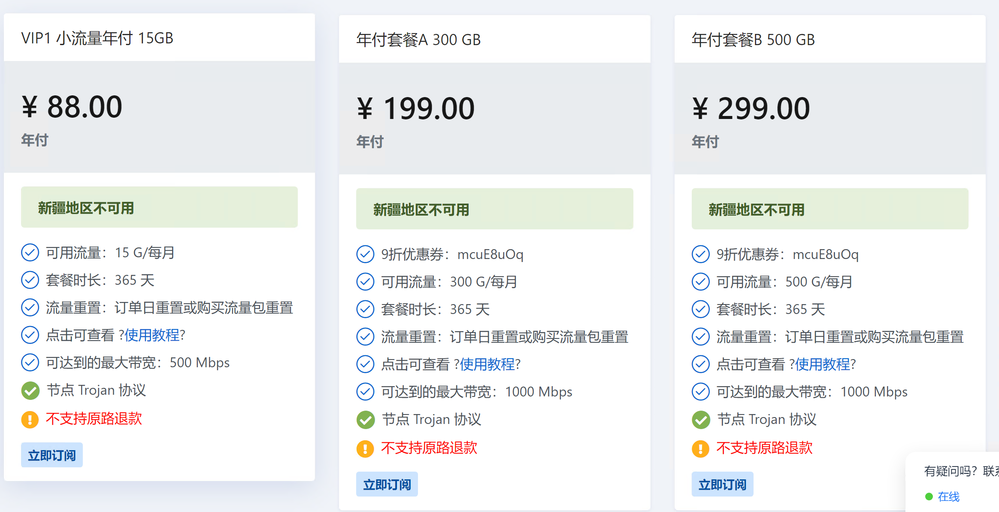](assets/review-images/3c558daa64ff1b15-original.png)

------

## 桔子云机场
桔子云（JuziCloud）成立于2020年，提供SSR/V2Ray订阅、CN2／BGP中转及IPLC专线，付费节点近50个。不同套餐开放的线路见下表。

**特点**：
流量充足，价格便宜：提供多种流量套餐，满足不同用户需求。

支持主流客户端：支持SSR和V2Ray协议，适用于多种设备。

全球节点分布：节点覆盖台湾、新加坡、日本、美国、香港等地区。

流媒体解锁：支持解锁Netflix、Hulu、HBO等流媒体服务。

客户端支持：在Android、iOS、macOS、Windows、Linux等平台都有客户端可用。

桔子云双十一年付7折码为`juzi778`，有效期至2026年11月30日。已有套餐的用户从桔子云首页“升级套餐”入口购买，在结算页确认折后金额。

👉 **[桔子云机场官网注册入口](https://so.dianlanla.com/juziyun)**

###  套餐详情介绍

| 套餐 | 价格 | 计费方式 | 每月流量 | 最大速率 | 同时连接设备数 | 其他特点 |
|------|------|----------|---------|---------|-------------|---------|
| **入门版** | ¥19.99 | 月付 | 100GB | 60Mbps | 2台 | 支持SSR/V2ray，国内中转节点，解锁流媒体，仅可用入门版节点 |
| **基础版** | ¥29.99 | 月付 | 200GB | 150Mbps | 3台 | 支持SSR/V2ray，国内中转节点，解锁流媒体，可用入门+基础版节点 |
| **标准版** | ¥39.99 | 月付 | 350GB | 300Mbps | 5台 | 支持SSR/V2ray，国内中转节点，解锁流媒体，可用入门+基础+标准版节点 |

[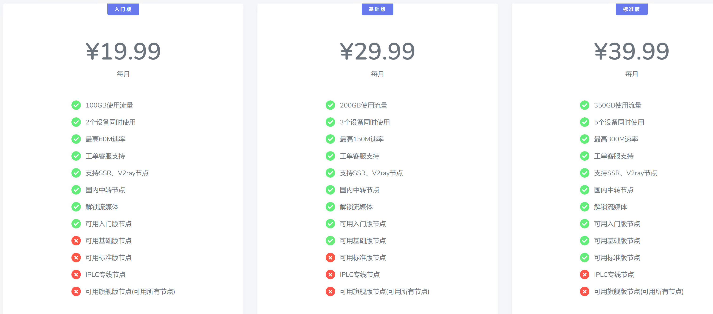](assets/review-images/29129a16e01c5439-original.png)

------
## 优信云机场

想要冷门国家的 IP 出口，去哪找？优信云走专线 Trojan 协议，卖点是节点铺得广——官网列出的可用地区超过 100 个，除了美国、日本、香港、台湾、韩国这些核心节点，还有大量长尾地区可选，适合对小众落地点有实际需求的用户，比如需要特定国家 IP 做流媒体解锁。

最低档月付十几元、100GB流量、限速200Mbps、2台设备，套餐有效期为30天。流量重置日期查看订单或账户记录；选择年付时，一并比较应付总额与流量规则。

👉 **[优信云机场官网注册入口](https://so.dianlanla.com/youxin)**

[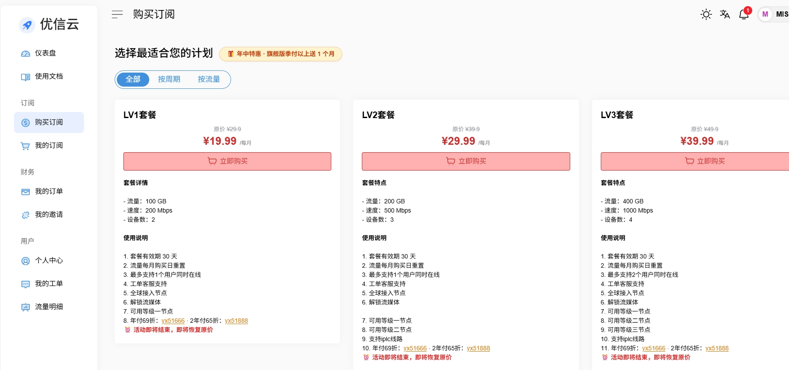](assets/review-images/3b51125670db3507-original.jpg)

------

## FSCloud机场
FSCloud机场是直连线路,入口为 Azure AWS 亚太, 节点使用Hysteria2协议，客户端需支持该协议。节点状态为bgp，电信用户自动分配为azure的入口，移动联通自动分配aws入口。netflix等主流流媒体解锁。

[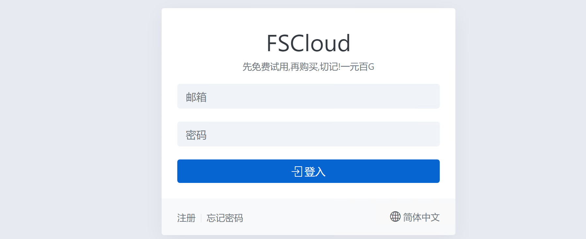](assets/review-images/d4f1eaf7ac9f49dd-original.png)
### 套餐（2026年11月资料）

| 套餐 | 月付 | 季付总价 | 半年总价 | 年付总价 | 两年总价 | 三年总价 | 流量 |
|---|---:|---:|---:|---:|---:|---:|---|
| 小份 | — | — | — | ¥13 | ¥25 | ¥35 | 100GB，重置周期未说明 |
| 中份 | — | ¥12 | ¥18 | ¥34 | — | ¥98 | 每月350GB |
| 大份 | ¥12 | ¥32 | ¥58 | ¥112 | ¥210 | ¥280 | 每月1200GB |

99.99% SLA与1Gbps是中份、大份卡片的标称条款，不套用到小份；补偿办法看服务条款。另有一次性¥99的“1000G流量”商品，但其说明写每月30G，额度口径矛盾，确认前不按1000GB总量购买。新用户说明列试用3天、购买后不退款，试用额度需在账户确认。

旧版套餐与价格记录

以下为旧版记录，保留供原订单对照；新购按上面的资料日期及本家商店查看。

###  优惠码
FSCloud提供新用户免费试用3天，购买后不支持退款。
###  套餐详情介绍

| 套餐名称  | 价格  | 付款周期 | 流量额度 | 解锁服务 | SLA保证 | 带宽 |
|----------|------|--------|---------|--------|--------|------|
| **小份套餐** | ¥13.00 | **年付** | 100GB，重置周期未明 | 未列明确范围 | 未列 | 未列 |
| **中份套餐** | ¥9.00  | **季付** | 350GB/月 | ✅ Netflix, ChatGPT | 99.99% | 1Gbps |
| **大份套餐** | ¥10.00 | **月付** | 1200GB/月 | ✅ Netflix, ChatGPT | 99.99% | 1Gbps |

 📢 **选购建议**  

✔ **年付最低支出** → 选 **小份套餐**（先确认100GB额度的重置周期）  
✔ **中等需求，价格划算** → 选 **中份套餐**（季度付，性价比不错）  
✔ **需要每月1200GB** → 选 **大份套餐**（先按月用量与付款周期比较）  

------

---

## flowercloud花云机场
**FlowerCloud花云机场**整合了国内多家运营商的网络，采用 **BGP智能分配线路**，结合多年的技术积累与创新，按运营商与目标地区分配入口。所有海外线路均通过全球领先的数据中心和 **运营商直签专线** 提供支持，提供不同地区的专线连接，延迟与吞吐需在自己的网络下比较。

该平台的线路覆盖了全球多个地区，包括 **香港、台湾、日本、新加坡、美国** 等地，广泛涵盖了 **亚洲、欧洲和美洲**，便于按所需地区选择出口。

### 优惠码
  当期优惠与适用套餐可在FlowerCloud结算页查看。

### FlowerCloud历史价格与付款周期  

| **套餐** | **月付** | **半年** | **年付** | **适用人群** |
|---------|--------|--------|--------|-------------|
| **Acceleration Lite** | ¥39 | ¥218 | ¥346 | **基础需求，日常轻度使用** |
| **Acceleration Plus** | ¥58 | ¥318 | ¥546 | **月付¥58，先核本档额度** |
| **Acceleration Max** | ¥113 | ¥618 | ¥946 | **月付¥113，先核线路与额度** |
| **Enterprise Basic** | ¥500 | ¥2888 | ¥5688 | **企业产品，先确认额度和授权范围** |
| **Enterprise** | ¥780 | ¥4000 | ¥7688 | **Enterprise产品，先确认使用许可** |
| **Global Acceleration Air** | — | — | **¥128/年** | **年付 20G/月，小流量用户** |

各档现有价格表未列全流量、设备数与节点范围，购买前在本家商品页取得这些具体条件，不能仅按价格判断能否满足视频或工作用途。

 **💡 付款比较**
✅ **需要最低月付价** → 旧表从**Acceleration Lite ¥39/月**起，流量与设备数仍需看商品说明。  
✅ **比较月付与长付支出** → **Acceleration Plus**列月付¥58、年付¥546，年付需一次付全款。  
✅ **需要Max档权益** → **Acceleration Max**（确认流量、速率和节点范围）  
✅ **比较Enterprise产品** → 先确认商业使用许可、额度与设备限制，再看**Enterprise Basic／Enterprise**的周期费用。  
✅ **长期备用 / 小流量需求** → **Global Acceleration Air**（适合轻量级用户）  

------

## 隐云机场

隐云的差异化路径在产品形态上就已经拉开 — 同一服务下并行两套订阅模式：专属客户端走"流量不限、设备数受控"，通用订阅走"设备不限、流量按月配额"。底层混合调度企业级 IPLC 与 IEPL 双专线，BGP 中转作为补充，整体可用性官方挂在 99.9%。覆盖范围在港台日新之外延伸到东南亚的马来西亚与泰国，再外扩到欧洲的英国与南美的巴西、阿根廷，整体超过 30 个国家与 100 个节点。"魔法节点"技术在服务端做智能分流，Netflix 与 Disney+ 等流媒体不再依赖客户端规则，ChatGPT 调用同样无需手动配置分流。标准版与高级版的两种模式同价，轻量版则分别为专属客户端¥29、通用订阅¥25。先选能覆盖用量与设备数的路线，再比较费用。

👉 **[隐云机场官网注册入口](https://so.dianlanla.com/yinyun)**

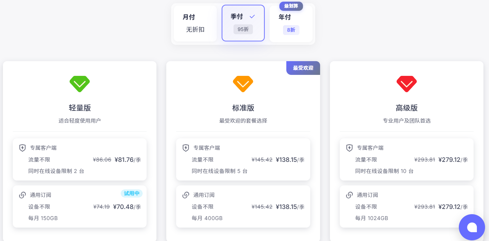

### 机场套餐

| 套餐名 | 月费 | 流量/月 | 设备数 | 接入方式 | 特殊功能 |
|---|---|---|---|---|---|
| 轻量版-专属客户端 | 29 元 | 不限 | 2 台 | 本家专属客户端 | 试用中，魔法节点解锁 |
| 轻量版-通用订阅 | 25 元 | 150 GB | 不限 | 目标格式从本家账户取得 | 多设备并发 |
| 标准版-专属客户端 | 49 元 | 不限 | 5 台 | 本家专属客户端 | 主推档位，智能分流 |
| 标准版-通用订阅 | 49 元 | 400 GB | 不限 | 目标格式从本家账户取得 | 设备无限制 |
| 高级版-专属客户端 | 99 元 | 不限 | 10 台 | 本家专属客户端 | 本人多设备，核对本档许可 |
| 高级版-通用订阅 | 99 元 | 1024 GB | 不限 | 目标格式从本家账户取得 | 大流量配额 |

周期折扣：月付无折扣、季付 9.5 折、年付 8 折。

选购建议：刚接触的用户先走轻量版-通用订阅，25 元 150GB 拿来摸节点质量；单人多设备且追剧节奏紧，专属客户端版本流量不限更省心；标准版 49 元两种模式，按"看重设备数还是流量"二选一；高级版两种路线分别列设备数10台或1TB流量。多人使用还要有相应共享许可，不能仅凭设备数当成团队授权。

------
## 百变小樱机场
百变小樱机场提供原生节点和IEPL专线，支持Netflix、ChatGPT、Disney等平台。下方试用可用于确认自己的网络和常用平台是否适合这些节点。

百变小樱提供注册免费24小时试用10GB，先试用再购买。

提供官网的Windows版、安卓版定制客户端。

###  套餐详情介绍

| **套餐**        | **价格** | **时长**  | **流量**  | **速率 & 特色**                      | **适合人群**             |
|---------------|---------|--------|---------|--------------------------------|------------------|
| **BASIC-初级套餐** | ¥98     | 365天   | 50GB/月  | 100Mbps，SSR协议，流媒体解锁 | **轻度用户**        |
| **PRO-初级1月**  | ¥15     | 30天    | 100GB   | 100Mbps，SSR协议，流媒体解锁 | **短期使用，灵活购买** |
| **PRO-初级3月**  | ¥45     | 90天    | 100GB/月 | 100Mbps，SSR协议，流媒体解锁 | **一次支付3个月**        |
| **PRO-初级6月**  | ¥90     | 180天   | 100GB/月 | 100Mbps，SSR协议，流媒体解锁 | **一次支付半年**      |
| **PRO-初级12月** | ¥180    | 365天   | 100GB/月 | 100Mbps，SSR协议，流媒体解锁 | **一次支付一年**      |
| **PRO-初级3年**  | ¥540    | 1095天  | 100GB/月 | 100Mbps，SSR协议，流媒体解锁 | **长期用户**        |

---

 🎯 **推荐选择**
每月用量不超过50GB时，可比较BASIC年付¥98与PRO月付¥15的流量及首次支出。需要100GB/月时，上表PRO的月、季、半年、年和三年付按月折算均为¥15，没有列出长期预付折扣；选择主要取决于付款周期。

📌 **所有套餐支持**：
- **100Mbps速率**
- **流媒体解锁（Netflix、Disney+ 等）**
- **SSR协议，国内加密隧道**
- **每日签到赠送流量**
- **最多3台设备同时在线**
- **30天周期流量重置**

---

## 蚯蚓机场
通过蚯蚓机场提供的服务器节点，可以在中国大陆及世界各地访问Google，Instagram，Facebook，观看YouTube，Netflix，使用telegram，WhatsApp等网站或APP。

 ### **套餐详情**  

| **套餐名称**  | **价格** | **流量** | **同时在线设备** | **可用节点** | **适用人群** |
|-------------|---------|----------|----------------|------------|---------|
| **个人基础版** | ¥20/月 | 80GB | 3 | 50+ | **轻度用户**，主要用于日常浏览 |
| **个人专业版** | ¥48/月 | 240GB | 10 | 50+ | **中等需求用户**，观看流媒体、AI工具 |
| **个人专业版+** | ¥68/月 | 360GB | 15 | 50+ | **大流量用户**，适合长时间在线视频 |
| **企业基础版** | ¥198/月 | 1400GB | 20 | 50+ | **小型团队**，按所列额度和在线数使用 |
| **企业专业版** | ¥398/月 | 3400GB | 40 | 50+ | **企业级用户**，大规模需求 |
| **抖咖传媒独享240GB** | ¥88/月 | 240GB | 20 | 60+ | **直播、电商用户**，专属节点 |
| **抖咖传媒独享880GB** | ¥198/月 | 880GB | 20 | 60+ | **高流量直播用户** |
| **一次性【68GB】** | ¥48/一次 | 68GB | 5 | 50+ | **偶尔使用**，长期有效 |
| **一次性【158GB】** | ¥108/一次 | 158GB | 5 | 50+ | **长期备用流量** |
| **定制套餐** | ¥1000/月 | **按需定制** | **按需定制** | **按需定制** | **特定需求** |

 **推荐选择**
- **轻度使用** → **个人基础版 ¥20/月（80GB）**
- **中等需求（流媒体、AI工具）** → **个人专业版 ¥48/月（240GB）**
- **高流量需求** → **个人专业版+ ¥68/月（360GB）**
- **团队、商务使用** → **企业基础版 ¥198/月（1400GB）**
- **直播、电商专属** → **抖咖传媒 ¥88/月（240GB）**
- **长期备用流量** → **一次性套餐（无到期限制）**

[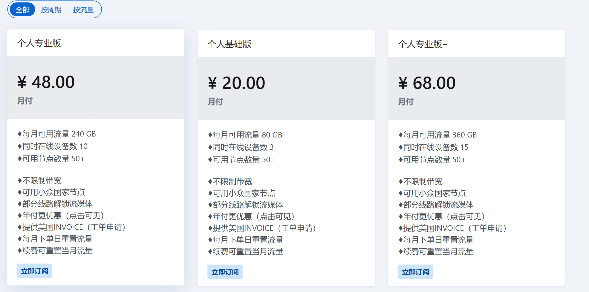](assets/review-images/2ac530462d4a037d-original.png)

------
## 可乐云机场
可乐云机场成立于2021年，提供100多个节点，线路包括电信CN2、移动CMI和IEPL国际专线。另有原生千兆独享节点定制，带宽、地址和价格按定制商品分别确认。
**特点**
IEPL专线：有相应线路节点，游戏或工作用途按目标地区与实际延迟选择。

多协议支持：支持Trojan、SSR、V2Ray等协议，适应不同网络环境。

流媒体解锁：支持解锁Netflix、Hulu、Disney+等流媒体服务。

全平台支持：提供Windows、Mac、Android等多平台客户端。

节点分布：节点覆盖香港、日本、新加坡、美国等多个国家和地区。

👉 **[可乐云机场官网注册入口](https://so.dianlanla.com/keyun)**

### 套餐与周期总价（2026年11月官网记录）

| 套餐 | 周期额度 | 月付 | 季付总价 | 半年总价 | 年付总价 | 两年总价 | 三年总价 |
|---|---:|---:|---:|---:|---:|---:|---:|
| Basic | 150G | ¥25 | ¥60 | ¥118 | ¥198 | — | — |
| Pro | 280G | ¥30 | ¥72 | ¥138 | ¥288 | — | — |
| Premium | 500G | ¥48 | ¥108 | ¥228 | ¥388 | — | — |
| Enterprise | 1TB | ¥68 | ¥198 | ¥388 | ¥688 | ¥1388 | ¥1888 |
| 150G按量 | 150G总量 | — | — | — | — | — | — |

150G按量包一次¥58。周期套餐的整期支出与每期额度分别比较；下面旧图的标准100G／¥25、进阶200G／¥30属于另一版商品，不能直接套用上面的周期价格。

旧版价格与原订单对照

###  套餐详情介绍

| 套餐 | 价格 | 计费方式 | 流量额度 | 速率 | 其他特点 |
|------|------|----------|---------|------|---------|
| **标准版** | ¥25.00 | 月付（旧图） | 100GB | 300Mbps+ | Trojan/SS/Hysteria协议，全球20+国家/60+节点，支持AI工具 & 流媒体 |
| **进阶版** | ¥30.00 | 月付（旧图） | 200GB | 300Mbps+ | Trojan/SS/Hysteria协议，全球20+国家/60+节点，支持AI工具 & 流媒体 |
| **150G按量计费** | ¥58.00 | 一次性 | 150GB (永久) | - | 多地BGP专线，包含所有节点 & 不限设备，支持AI工具 & 流媒体 |

[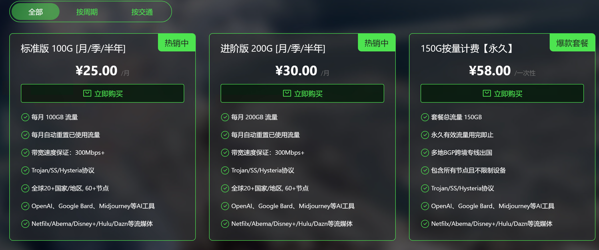](assets/review-images/33136a1789f3ba1d-original.png)

------

---

## GsouCloud机场

Gsou Cloud适用于macOS、iOS、Android、Windows和Linux，采用IXP互联线路。套餐按流量和设备数分档：SIMPLE每月100GB、6台，LITE每月150GB、8台。设备数与多人共享许可分别按套餐条款执行。

👉 **[GsouCloud机场官网注册入口](https://so.dianlanla.com/gsoucloud)**

[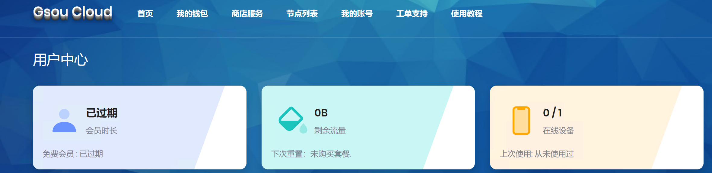](assets/review-images/36a7bb4662f8c7bf-original.png)

### 🌟 **SIMPLE / LITE / PRO / ULTRA 套餐详情对比表**  

| **套餐**        | **月付** | **季度** | **半年** | **年付**  | **流量**       | **设备限制** | **速率**   | **VIP等级** | **可用节点**       | **适合人群**         |
|---------------|--------|--------|--------|---------|------------|------------|-----------|------------|-------------|------------------|
| **SIMPLE**    | ¥25    | -      | -      | -       | 100GB/月   | 6个设备    | 100Mbps   | SIMPLE版    | 基础/专线节点 | 轻度用户，普通浏览  |
| **LITE**      | ¥30    | -      | -      | -       | 150GB/月   | 8个设备    | 100Mbps   | LITE版      | 基础/专线节点 | 适合中度流媒体使用 |
| **PRO**       | ¥35    | -      | -      | -       | 225GB/月   | 10个设备   | 100Mbps   | PRO版       | 基础/专线节点 | 高度流媒体用户     |
| **PRO ULTRA** | -      | -      | -      | ¥1499   | 18888GB/年 | 30个设备   | 100Mbps   | PRO版       | 基础/专线节点 | 超级用户/多设备需求 |

 🎯 **推荐建议**
- **普通用户（上网、轻度流媒体）** 👉 **SIMPLE ¥25/月**（100GB/月，6设备）  
- **每月150GB与8台设备** 👉 **LITE ¥30/月**（150GB/月，8设备）  
- **每月225GB与本人多设备需求** 👉 **PRO ¥35/月**（225GB/月，10设备）  
- **一年总量18888GB与30台设备条件** 👉 **PRO ULTRA ¥1499/年**（18888GB/年，30设备）  

------
## ByWave机场

### ByWave周期与流量补充（资料日期：2026-09-07）

Bronze月付¥30、每月150GiB，Gold月付¥60、每月500GiB，Platinum月付¥110、每月1TiB；Special年付¥140、全年总量200GiB，不重置。Gold与Platinum含Emby账号权益。

套餐字段与界面文字的设备限制存在差异，不给出确定设备数；设备上限购买前向服务方确认。下面按对应日期分别列周期套餐与总量包。

**ByWave加速器**使用SS与V2Ray协议，提供IPLC专线、BGP隧道中转与智能选路。选择时一起比较付款周期、节点范围和客户端兼容；遇到入口维护，按ByWave首页公告切换节点或更新订阅。

🟢 **优势总结**：
- 线路资料标示全线IPLC，可结合当前入口与所需地区比较
- 标称10G线路带宽，实际速率按节点与本地网络观察
- 支持流媒体、游戏与办公，可按所需地区选择节点
- 支持 SS / V2Ray 协议，自由切换
- BGP 隧道中转 + 智能选路，按本地运营商与所需地区选择

👉 **[ByWave机场官网注册入口](https://so.dianlanla.com/bywave)**

[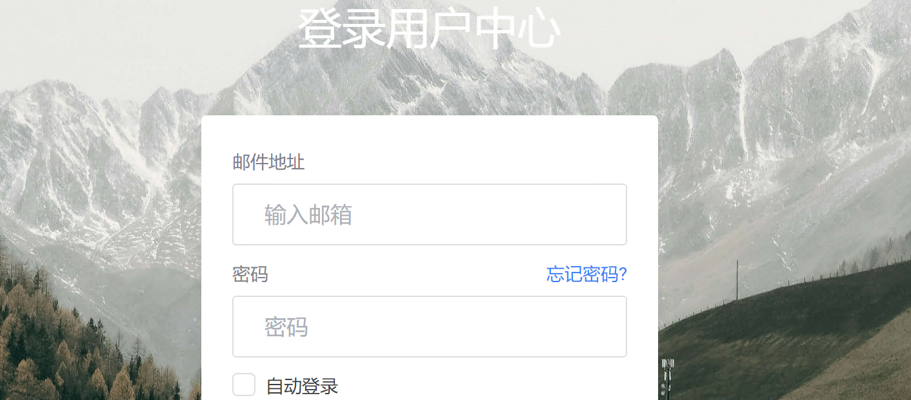](assets/review-images/25e532f08208828d-original.png)

###  优惠码
表中价格未扣优惠，实际折扣见结算页。

### 🧾 **套餐列表与详情**

| 套餐名      | 价格             | 流量政策                        | 节点&解锁服务                        | 速率/设备限制            | 流量重置 | 手动重置 | 其他说明 |
|-------------|------------------|----------------------------------|--------------------------------------|---------------------------|------------|-------------|----------|
| **Special** | ¥140 / 360天     | ✅ **200GiB/年**  ❌ 不可续费 | ✅ 标称万兆IEPL专线 ✅ 解锁 Netflix / ChatGPT | 🚫 限速：**100Mbps** 设备上限待确认 | ❌ 不重置 | ❌ 无法重置 | 一次性买断 |
| **Bronze**  | ¥30 / 月         | ✅ 150GiB/月                     | ✅ 标称万兆IEPL专线 ✅ 解锁 Netflix / ChatGPT | ✅ **500Mbps** 设备上限待确认 | ✅ 每月购买日 | ¥24 | 实用型月付 |
| **Gold** 🔥热销 | ¥60 / 月     | ✅ 500GiB/月                     | ✅ 标称万兆IEPL专线 ✅ 解锁 Netflix / ChatGPT 🎁 专属 **Emby** | ✅ **1000Mbps** 设备上限待确认 | ✅ 每月购买日 | ¥48 | 适合串流大户 |
| **Platinum** | ¥110 / 月       | ✅ 1TiB/月                    | ✅ 标称万兆IEPL专线 ✅ 解锁 Netflix / ChatGPT 🎁 专属 **Emby** | 🚀 **无限速率** 设备上限待确认 | ✅ 每月购买日 | ¥88 | 极速体验 |

---

### 📝 **选择建议**

| 使用场景                | 推荐套餐       | 原因说明                              |
|-------------------------|----------------|---------------------------------------|
| 偶尔使用 / 轻量访问     | **Special**    | 全年总量200GiB，不能当每月额度                      |
| 日常轻度使用            | **Bronze**     | 每月150GiB，按月续费                  |
| 常用串流 & AI工具       | **Gold** 🔥     | 每月500GiB，含Emby账号权益                |
| 重度使用 / 高流量需求   | **Platinum**   | 每月1TiB，设备上限另确认               |

------
## 奶茶Cloud机场
奶茶Cloud此前介绍过Hysteria2测试节点，并提供[Hiddify-next相关导入说明](https://github.com/John19187/proxy-client-guides/blob/main/downloads/hiddify/README.md#import)。使用前在本家账户查看当前节点和对应教程，按协议与订阅格式选择客户端；[Hiddify安装与导入](https://github.com/John19187/proxy-client-guides/blob/main/downloads/hiddify/README.md#import)和[sing-box配置教程](https://github.com/John19187/proxy-client-guides/blob/main/downloads/sing-box/README.md#import)分别说明各自输入。按当前客户端、内核版本与本家配置核对兼容条件。

👉 **[奶茶Cloud机场官网注册入口](https://so.dianlanla.com/naichatea)**

[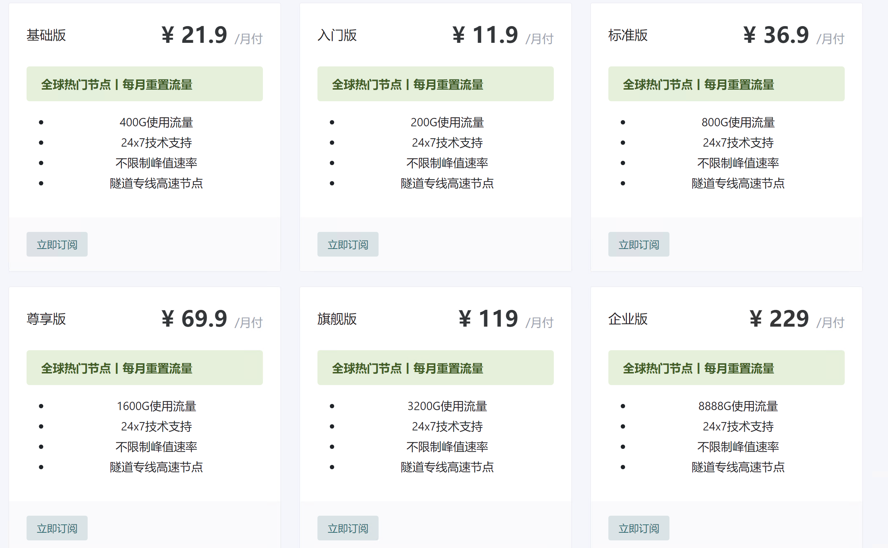](assets/review-images/d0e4a5ba75b971d9-original.png)
 **优惠码**
下表按套餐原价比较，活动折扣可在奶茶云结算页查看。

### 套餐对比表格  

| 套餐 | 价格 | 计费方式 | 流量与周期 | 速率 | 其他特点 |
|------|------|----------|---------|------|---------|
| **入门版** | ¥11.9 | 月付 | 200G | 不限速 | 全球热门节点，24x7技术支持，隧道专线高速节点 |
| **基础版** | ¥21.9 | 月付 | 400G | 不限速 | 全球热门节点，24x7技术支持，隧道专线高速节点 |
| **标准版** | ¥36.9 | 月付 | 800G | 不限速 | 全球热门节点，24x7技术支持，隧道专线高速节点 |
| **尊享版** | ¥69.9 | 月付 | 1600G | 不限速 | 全球热门节点，24x7技术支持，隧道专线高速节点 |
| **旗舰版** | ¥119 | 月付 | 3200G | 不限速 | 全球热门节点，24x7技术支持，隧道专线高速节点 |
| **企业版** | ¥229 | 月付 | 8888G | 不限速 | 全球热门节点，24x7技术支持，隧道专线高速节点 |
| **赞助版** | ¥1888 | 一次性 | 原商品称不限流量，具体期限与公平使用条款需核对 | 不限速 | 全球热门节点，24x7技术支持，高端独享节点，不限在线客户端，隧道专线高速节点 |

------
## 万城Vcity机场

万城Vcity提供周期套餐和一次性流量包。先按月用量与总量需求选计费方式，再对照下方价格、节点和设备条件。

 **优惠码**
下表按套餐原价比较。购买流量包时，单独查看该商品的优惠条件。

👉 **[万城Vcity机场官网注册入口](https://so.dianlanla.com/wancheng)**

### **月付套餐**  

| 套餐 | 价格 | 每月流量 | 其他特点 |
|------|------|---------|---------|
| **体验** | ¥12.00 | 6GB | ⚠️流量少，优惠不适用，最高1000Mbps，全域企业级IEPL专线，支持GPT/流媒体解锁，近50国节点 |
| **迷你** | ¥22.00 | 120GB | 历史优惠说明，当前订单折扣需核对，其他同上 |
| **入门** | ¥38.00 | 220GB | ★热门套餐，历史优惠说明，当前订单折扣需核对，其他同上 |
| **标准** | ¥68.00 | 380GB | ★热门套餐，历史优惠说明，当前订单折扣需核对，其他同上 |
| **专业** | ¥138.00 | 780GB | 历史优惠说明，当前订单折扣需核对，其他同上 |

### **一次性流量包套餐**  

| 套餐 | 价格 | 总流量 | 使用期限 | 其他特点 |
|------|------|-------|---------|---------|
| **小包** | ¥88.00 | 60GB | 1年 | 最高1000Mbps，全域企业级IEPL专线，支持GPT/流媒体解锁，近50国节点 |
| **中包** | ¥128.00 | 260GB | 1年 | 其他同上 |
| **大包** | ¥298.00 | 580GB | 终身 | ★热门套餐，其他同上 |
| **超大包** | ¥598.00 | 1300GB | 不限使用期 | 其他同上 |

[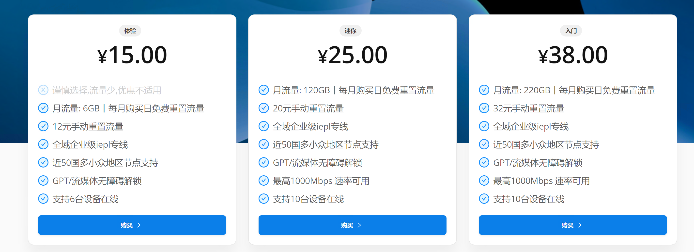](assets/review-images/9b8af2800d71857d-original.png)

------
## 泡芙云机场

泡芙云由海外团队运作，使用SS、SSR协议和IEPL内网专线，支持Netflix、Disney+等流媒体。可按每月流量、设备数与常用地区比较各档套餐，活动费用与适用条件在泡芙云账户中查看。

👉 **[泡芙云机场官网注册入口](https://so.dianlanla.com/paofu)**

[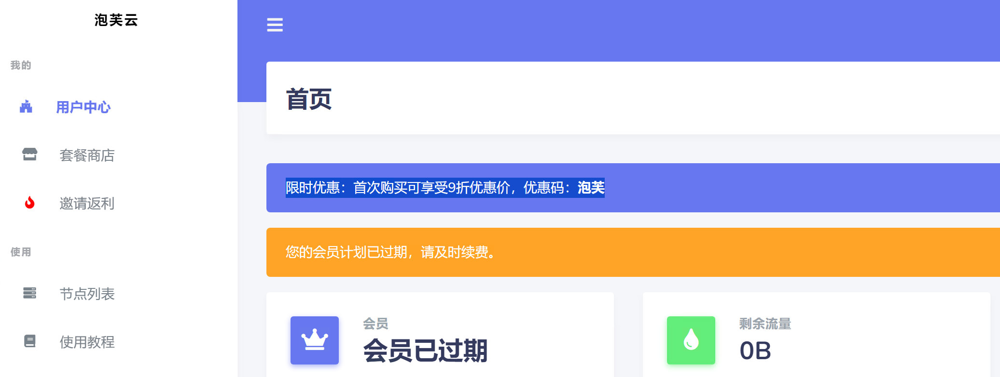](assets/review-images/9f32ffa3b96741d3-original.png)

  当期优惠与适用套餐可在泡芙云结算页查看。

### 新套餐（2026年11月5日）

| 套餐 | 月付总价 | 每月流量 | 在线设备 | 速率条款 |
|---|---:|---:|---:|---|
| 轻量 | ¥12 | 100GB | 2 | 不限制速率 |
| 进阶 | ¥22 | 220GB | 3 | 不限制速率 |
| 旗舰 | ¥36 | 500GB | 5 | 不限制速率 |
| 旗舰团队 | ¥99 | 1500GB | 10 | 不限制速率 |

四档新商品都标示不限速率，区别在月流量和在线设备数。旧轻量50GB／200Mbps属于下面的旧版，不能把旧限制与新套餐拼在一起。

旧版套餐与价格记录

以下为旧版记录，保留供原订单对照；新购按上面的资料日期及本家商店查看。

###  套餐详情介绍

| 订阅计划       | 价格 (¥) | 流量   | 在线设备 | 速率限制 | 适合用户         | 其他特点 |
|-------------|--------|------|------|------|------------|------|
| **新用户试用**  | ¥1 / 3天 | 10GB  | 2台   | 无限制 | 试用用户，短期体验 | 🚀 Netflix/迪士尼解锁 |
| **轻量泡芙**  | ¥12 / 月 | 50GB  | 2台   | 200Mbps | 轻量用户，备用流量 | 🚀 Netflix/迪士尼解锁 |
| **小泡芙**  | ¥22 / 月 | 200GB | 2台   | 无限制 | 日常使用，社交媒体 | 🚀 Netflix/迪士尼解锁 |
| **大泡芙**  | ¥32 / 月 | 300GB | 3台   | 无限制 | 适合流媒体观看 | 🚀 Netflix/迪士尼解锁 |
| **旗舰泡芙**  | ¥42 / 月 | 400GB | 5台   | 无限制 | 追剧、游戏、下载 | 🚀 Netflix/迪士尼解锁 |
| **团队泡芙**  | ¥72 / 月 | 700GB | 10台  | 无限制 | 多人共享，大流量需求 | 🚀 Netflix/迪士尼解锁 |
| **旗舰团队**  | ¥102 / 月 | 1TB  | 20台  | 无限制 | 企业、团队用户 | 🚀 Netflix/迪士尼解锁 |

---

🏆 **选购建议**
- **新用户试用** 🆕：🔹 **新用户试用**（仅 ¥1，体验 3 天）
- **轻度用户** 🎈：🔹 **轻量泡芙**（¥12，50GB/月）
- **日常社交+流媒体** 📺：🔹 **小泡芙**（¥22，200GB/月）
- **追剧游戏党** 🎮：🔹 **大泡芙**（¥32，300GB/月）
- **流量需求高** 🚀：🔹 **旗舰泡芙**（¥42，400GB/月）
- **多人使用，家庭/团队** 👨‍👩‍👧‍👦：🔹 **团队泡芙 / 旗舰团队**（700GB-1TB/月）

旧表列普通款与旗舰款IEPL线路及流媒体支持；其中轻量档限200Mbps，其他档的速率按各自商品条件，不能统称无限速。

[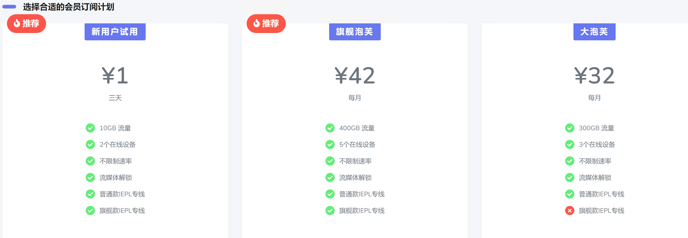](assets/review-images/3f30e683e3b54d46-original.png)

------

---

## Web3加速器

Web3加速器提供专线节点
特点
1、全IPLC专线机场，落地原生IP，所有节点1倍率，3Gbps带宽专线，SS协议、晚高峰不限速/不降速。

2、提供双入口专线。某一入口维护时，可按Web3加速器首页公告切换到可用入口。

3、支持Netflix、Disney+、HBO等流媒体，以及ChatGPT、Gemini、Copilot等AI工具；支持TikTok短视频运营和直播。

4、支付宝、usdt支付支持。还支持web3钱包登录。

5、遇到节点或入口调整，留意Web3加速器首页的线路通知，及时更新订阅。

### 套餐价格

| 套餐 | 每月流量(GB) | 月付(元) | 季付(元) | 半年(元) | 年付(元) |
| :--: | :----------: | :------: | :------: | :------: | :------: |
| VIP1 |     100      |    25    |    67    |    ❌     |   250    |
| VIP2 |     300      |    55    |   149    |    ❌     |   550    |
| VIP3 |     800      |    88    |   238    |    ❌     |   880    |

### 速度测试

评估线路时，用自己的常用网站、流媒体或工作应用查看访问效果，再结合常用时段的延迟、丢包和下载表现选择。本家提供试用时，可按试用额度完成这些比较。

------
## 飞机云机场
飞机云机场成立于2022年，提供Shadowsocks（SS）和V2Ray订阅，套餐按流量与价格分档，支持Netflix、Disney+等平台。

**特点**：
IPLC专线：按套餐开放范围选择对应节点。

多协议支持：支持SSR和V2Ray协议，适用于多种设备。

全平台支持：支持Windows、macOS、iOS、Android等多种操作系统。

流媒体解锁：支持解锁Netflix、Hulu等流媒体服务。

客户服务：提供工单和在线客服支持。

飞机云双十一年付7折码为`FJ1234`，有效期至2026年11月30日。已有套餐的用户从飞机云首页“升级套餐”入口购买，在结算页确认折后金额。

👉 **[飞机云机场官网注册入口](https://so.dianlanla.com/feijiyun)**

### 套餐额度与月付价（2026年11月官网记录）

| 套餐 | 月付价格 | 月付套餐额度 | 同时使用设备 | 原页速率标记 |
|---|---:|---:|---:|---|
| 入门版 | ¥14.99 | 50GB | 1 | 最高60M |
| 基础版 | ¥19.99 | 100GB | 2 | 最高60M |
| 标准版 | ¥29.99 | 200GB | 3 | 最高150M |
| 高级版 | ¥39.99 | 350GB | 5 | 最高300M |
| 旗舰版 | ¥55.99 | 600GB | 8 | 不限速率 |
| 旗舰版大流量 | ¥95.99 | 1200GB | 10 | 不限速率 |

各档商品均提供国内中转和IPLC节点。速率单位标为M，购买前向飞机云客服确认是Mbps还是其他单位。下方多周期旧价格供老用户对照。

旧版价格与原订单对照

###  套餐详情介绍
|套餐|入门版|基础版|标准版|高级版|旗舰版|
|----|----|----|----|----|----|
|月付|￥12.9|￥18.9|￥28.9|￥38.9|￥55.9|
|季付|￥38.9|￥56.9|￥86.9|￥116.9|￥167.9|
|半年付|￥77.9|￥113.9|￥173.9|￥233.9|￥335.9|
|年付|￥155.8|￥227.8|￥347.8|￥467.8|￥671.8|
|两年付|￥311.7|￥455.7|￥695.7|￥935.7|￥1343.7|
[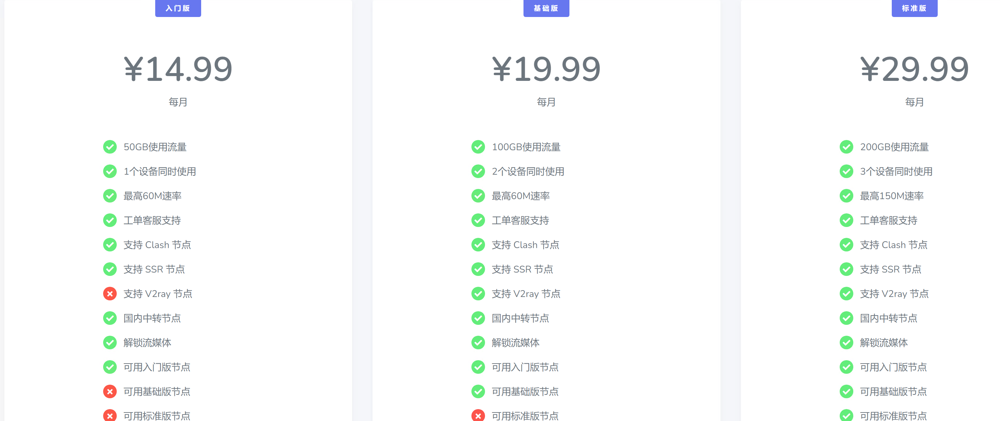](assets/review-images/c318ec14cb2ceecd-original.png)

------

---

## 灯塔Cloud机场

灯塔Cloud机场 提供IEPL节点；套餐按流量、付款周期及线路条件区分。

🎯 灯塔Cloud机场特色：

48+ 高速线路：按需要的出口地区选择节点

流媒体解锁：解锁 Netflix、HBO Max、Amazon Prime Video、Disney+ 等平台

高流量与带宽：不同套餐的月流量与速率不同，按下表对应档位比较

官网全平台客户端：按系统下载与登录，入口变更时仍需查看本家首页公告

注册试用：首次注册即享 60分钟10GB 高速流量，先体验再决定购买

👉 **[灯塔Cloud机场官网注册入口](https://so.dianlanla.com/dengta)**

[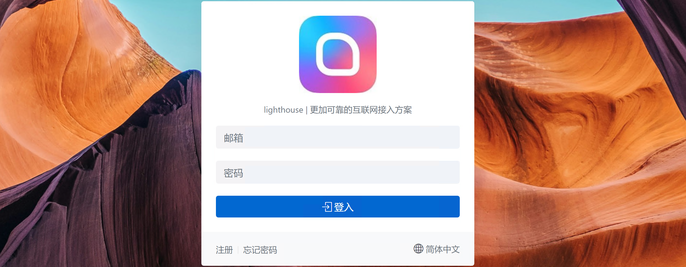](assets/review-images/a44a79897a75384c-original.png)

### 新套餐（2026年11月4日）

| 套餐 | 每月流量 | 季付总价 | 半年总价 | 年付总价 | 两年总价 | 三年总价 |
|---|---:|---:|---:|---:|---:|---:|
| 专业互联 · Pro | 400GB | ¥119.99 | ¥229.99 | ¥429.99 | ¥764.99 | ¥999.99 |
| 标准接入 · Lite | 80GB | ¥69.99 | ¥124.99 | ¥244.99 | ¥444.99 | ¥569.99 |
| 极致商务 · Ultra | 1000GB | ¥199.99 | ¥379.99 | ¥714.99 | ¥1274.99 | ¥1664.99 |

Lite／Pro／Ultra每30天分别重置80／400／1000GB；三档均写不限制本人设备数。另有1TB不限时总量包，一次¥650，不重置，用完为止。

三档速率原文写100／500／800MBps，购买前向服务方确认它是否指兆字节每秒，不能与Mbps直接当成同一个单位。下方旧VIP表里的“6条线路”是线路数，不是可在线设备数。

旧版套餐与价格记录

以下为旧版记录，保留供原订单对照；新购按上面的资料日期及本家商店查看。

###  套餐详情介绍

| **套餐名称**         | **价格**        | **流量**   | **速度/带宽**        | **设备**  | **线路**              | **其他特点** |
|----------------------|---------------|------------|----------------------|------------|----------------------|--------------|
| **标准版 (VIP0)**   | ¥60 /半年付    | 100GB/月   | 不保证速率           | 未明确设备数；另列6条线路 | VIP0 线路              | 全中转隧道，不享受优惠券 |
| **个人套餐 (VIP1)**  | ¥79 /季付      | 600GB/月   | 峰值 500Mbps         | 不限设备数 | VIP0-VIP1 节点        | IEPL专线，支持ChatGPT与流媒体 |
| **个人套餐 (VIP2)**  | ¥145 /半年付   | 600GB/月   | 峰值 1500Mbps        | 不限设备数 | VIP0-VIP1-VIP2 节点  | IEPL专线，支持ChatGPT与流媒体 |
| **个人套餐 (VIP2)**  | ¥269 /年付     | 600GB/月   | 峰值 2000Mbps        | 不限设备数 | VIP0-VIP1-VIP2 节点  | IEPL专线，支持ChatGPT与流媒体 |

 **📢 选购建议**  

✅ **日常轻量使用（网页浏览、低需求流媒体）**  
➡ **标准版 VIP0** (¥60 /半年付, 100GB/月) 适合基础需求，不保证速率但有6条高速线路。

✅ **中等需求（流媒体、AI应用、科研加速）**  
➡ **个人套餐VIP1**为¥79/季付，每月600GB、标称500Mbps，提供IEPL专线，支持流媒体和ChatGPT。需要独享带宽或IP时，购买前向灯塔云客服确认所选套餐是否提供。

✅ **需要VIP2线路范围与月额度**  
➡ **个人套餐 VIP2** (¥145 /半年付, 600GB/月, 1500Mbps) 多出VIP2节点范围，速率是标称上限。  

✅ **旧VIP2年付费用比较**  
➡ **个人套餐 VIP2** (¥269 /年付, 600GB/月, 2000Mbps) 按旧价一次支付¥269；和半年付¥145比较时，还要看原订单权益和整期支出。

------

---

## 奈云机场

奈云机场提供专业的海外网络加速解锁，IPLC专线节点 🚀 支持加速访问：ChatGPT Google Facebook TikTok Instagram WhatsApp Messenger等等一系列网站 🔑解锁NF/HBO/Bilibili港澳台/HULU/动画疯/Pixiv等流媒体

* * *

👉 **[奈云机场官网注册入口](https://so.dianlanla.com/naiyun)**

### 奈云机场套餐信息

| 套餐类型         | 价格       | 流量     | 备注                        |
| ---------------- | ---------- | -------- | --------------------------- |
| **月付**         | ¥28.00/月  | 388G     | 支持5台设备与流媒体 |
|                  | ¥49.00/月  | 788G     | 支持5台设备与流媒体 |
| **年付**         | ¥128.00/年 | 每月168G | 支持5台设备与流媒体 |
| **不限时流量包** | ¥98.00/次  | 280G     | 不限时间，支持5台设备       |
|                  | ¥218.00/次 | 680G     | 不限时间，支持5台设备       |
|                  | ¥498.00/次 | 2048G    | 不限时间，支持5台设备       |

 选购建议

1. **月付套餐**：
   - **¥28.00/月，388G流量**：适合偶尔使用流媒体服务的用户。
   - **¥49.00/月，788G流量**：适合频繁使用流媒体服务或需要较高流量的用户。

2. **年付套餐**：
   - **¥128.00/年，每月168G流量**：适合长期使用且流量需求稳定的用户，性价比较高。

3. **不限时流量包**：
   - 适合不确定流量需求或需要长期使用的用户。例如：
     - **¥98.00/次，280G流量**：适合短期内流量需求较小的用户。
     - **¥218.00/次，680G流量**：适合中等流量需求的用户。
     - **¥498.00/次，2048G流量**：适合长期使用且流量需求较大的用户。
       [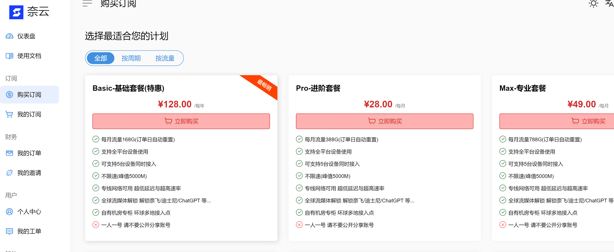](assets/review-images/c109bba1c8669548-original.png)

---
## 网际快车 (Flash Express)

**简介：** 网际快车是一款主打**中转专线**与**家宽原生节点**的高性能加速服务。线路介绍包括高带宽中转和家宽出口，晚高峰延迟、丢包仍需在实际节点上比较。平台提供超过50个国家的节点覆盖，特别针对 AI 工具（ChatGPT、Claude）及流媒体（Netflix、Disney+）进行了原生 IP 解锁，需要这些平台或特定出口时，可按节点地区与账号条件选择。

`网际快车 基本信息`
**线路协议：** 专用VPN协议 & Shadowsocks (SS) 三方通用订阅
**核心技术：** 中转专线、家宽/住宅原生节点
**基础套餐：** 流量包模式（流量永不过期）
**试用条件：** 2026年11月，网际快车提供¥6.80、20GB总量的试用包，一次购买、用完为止，不按月重发。试用包从账户商店购买。
**流媒体解锁：** Netflix、Disney+、Hulu等。
**AI服务支持：** ChatGPT、Claude、Gemini、Midjourney等。
**节点分布：** 美国、香港、日本、新加坡、英国、德国等50+国家
**客户端支持：** 自家专用客户端、Clash、[Shadowrocket](https://github.com/John19187/proxy-client-guides/blob/main/downloads/shadowrocket/README.md#import)、V2Ray 等
**特色服务：** 不限设备连接数、总量包流量不过期

👉 **[网际快车官网注册入口](https://so.dianlanla.com/flashexpress)**

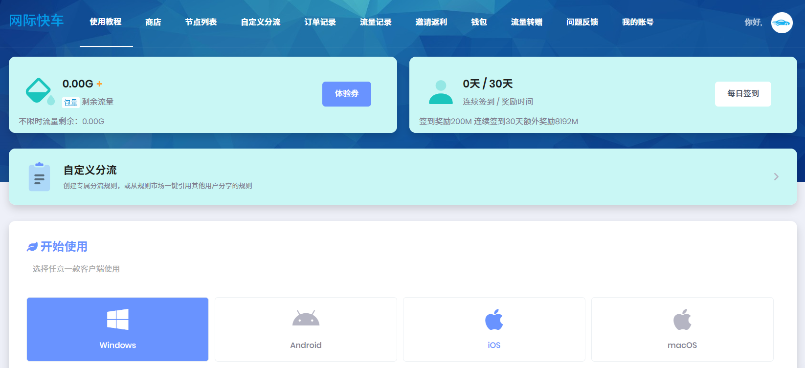

### 📊 网际快车 套餐价格对比表

| **套餐类型**  | **套餐名称** | **价格** | **流量额度**            | **有效期**     | **核心特色**              |
| ------------- | ------------ | -------- | ----------------------- | -------------- | ------------------------- |
| **试用/入门** | **试用套餐** | ¥6.8     | **20 GB**               | **永久不过期** | 付费试用总量，非每月重置    |
| **不限时间**  | **标准套餐** | ¥16      | **100 GB**              | **永久不过期** | 性价比之选，轻度使用首选  |
| **不限时间**  | **优选套餐** | ¥29      | **200 GB**              | **永久不过期** | 网页办公/偶尔追剧推荐     |
| **不限时间**  | **高级套餐** | ¥49      | **380 GB**              | **永久不过期** | 均衡配置，长效备用        |
| **不限时间**  | **大神套餐** | ¥118     | **1000 GB**             | **永久不过期** | 囤量首选，大文件下载无忧  |
| **不限时间**  | **至尊套餐** | ¥198     | **1980 GB**             | **永久不过期** | 封顶配置，极高性价比      |
| **周期包时**  | **包月套餐** | ¥24      | **50GB /天** (共1500G)  | 30 天          | 每日重置，适合重度视频党  |
| **周期包时**  | **包季套餐** | ¥58      | **50GB /天** (共4500G)  | 90 天          | 季度长效，日均不到 7 毛钱 |
| **周期包时**  | **包年套餐** | ¥186     | **50GB /天** (共18250G) | 365 天         | 365天有效，按每日50GB使用    |

------

#### 🛠️ 全套餐通用服务承诺

- **设备限制：** 全套餐均 **不限制** 同时在线设备数量。
- **线路：** 采用专线，适用于高清视频等大流量需求。
- **解锁支持：** ChatGPT、Claude及Netflix、Disney+。
- **叠加逻辑：** 再次购买同类型套餐，流量总量或服务时间将**自动叠加**。
- 
#### 💡 计费与使用规则说明

> **流量消耗优先级：**
>
> 系统优先扣除 **[包时套餐]** 的每日额度；当每日额度用完或套餐到期后，才会自动消耗 **[包量套餐]** 中的余额。
>
> - **包量（不限时）：** 买多少用多少，流量永不过期，再次购买总量自动叠加。
> - **包时（月/季/年）：** 每天都有大量额度，再次购买时长自动累加。

------
---
## 霓虹

维尼（霓虹云）提供大陆BGP多线入口与VMess中转节点，套餐按每月250GB、1000GB和3000GB流量分档，支持Netflix等流媒体及ChatGPT。日志记录范围和隐私条款见本家政策。

👉 **[霓虹机场官网注册入口](https://so.dianlanla.com/nihong)**

### **套餐概览**

| 套餐名称 | 价格      | 流量      | 最高速度 | 设备数 | 特点                             |
| -------- | --------- | --------- | -------- | ------ | -------------------------------- |
| 小罐蜂蜜 | ¥10.00/月 | 250GB/月  | 1000Mbps | 不限   | Netflix/ChatGPT解锁，大陆BGP多线 |
| 大罐蜂蜜 | ¥25.00/月 | 1000GB/月 | 2500Mbps | 不限   | 同上                             |
| 一桶蜂蜜 | ¥45.00/月 | 3000GB/月 | 5000Mbps | 不限   | 同上                             |

**推荐选择**

- **轻度使用（日常浏览）** → 小罐蜂蜜（¥10.00/月, 250GB/月）
- **中等需求（流媒体使用）** → 大罐蜂蜜（¥25.00/月, 1000GB/月）
- **高性能需求（高清流媒体/大规模下载）** → 一桶蜂蜜（¥45.00/月, 3000GB/月）

## 虫洞云机场
**虫洞云机场** 是一家提供多地区代理节点的服务平台，专注于全球网络加速。平台拥有超过 30 个优质节点，包括香港、日本、韩国、新加坡、美国等，可按目标地区选择相应节点。

虫洞支持多平台操作系统，提供设置说明与一键导入功能。流量额度和峰值速率按套餐区分；下表的月付配额与年付总量包分别比较，流量额度与峰值速率分别查看。

虫洞支持Netflix、Hulu、HBO、Disney+、DAZN等流媒体，可按目标平台选择节点地区。

🚀 **虫洞云机场特点**：
- 高速节点：台湾、香港、日本、韩国等地区节点  
- 专属虫洞APP客户端，简化操作  
- 解锁流媒体：支持 Netflix、Hulu、HBO、Disney+、DAZN 等平台  
- 峰值速率：本节套餐表分别列100、300和500Mbps，按所选档位核对
- 流量额度：本节月付表列200、500和1000GB；年付总量包另列，不按月重发

👉 **[虫洞云机场官网注册入口](https://so.dianlanla.com/chongdong)**

[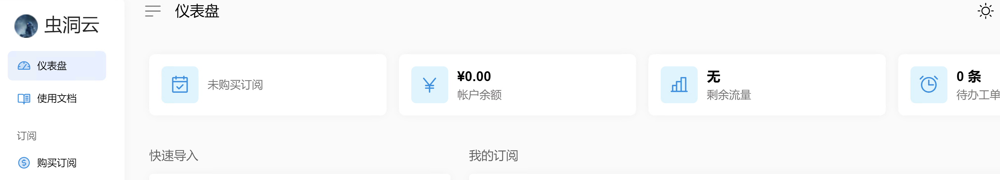](assets/review-images/05b1325873414821-original.png)

###   套餐详情

| **套餐名称**         | **价格**          | **流量**             | **重置日期**                | **流媒体支持**                          | **设备支持**                       | **峰值速率** | **其他说明**           |
|---------------------|------------------|----------------------|----------------------------|-----------------------------------------|------------------------------------|--------------|------------------------|
| **Platinum**         | ¥19.00/月        | 每月200GB            | 每月购买日重置流量，手动重置流量 ¥19/次 | Netflix, Hulu, HBO, Disney+, DAZN等流媒体 | SS加密协议，支持 3 台设备同时使用    | 100Mbps     | 无退款服务，介意勿买   |
| **Diamond**          | ¥49.00/月        | 每月500GB            | 每月购买日重置流量，手动重置流量 ¥49/次 | Netflix, Hulu, HBO, Disney+, DAZN等流媒体 | SS加密协议，支持 5 台设备同时使用    | 300Mbps     | 无退款服务，介意勿买   |
| **Ultimate**         | ¥99.00/月        | 每月1000GB           | 每月购买日重置流量，手动重置流量 ¥99/次 | Netflix, Hulu, HBO, Disney+, DAZN等流媒体 | SS加密协议，支持 5 台设备同时使用    | 500Mbps     | 无退款服务，介意勿买   |
| **轻享500G**         | ¥99.00/年        | 一次性 500GB         | 购买日起有效期1年            | Netflix, Hulu, HBO, Disney+, DAZN等流媒体 | SS加密协议，支持 5 台设备同时使用    | 500Mbps     | 无退款服务，介意勿买   |
| **畅享2000G**        | ¥299.00/年       | 一次性 2000GB        | 购买日起有效期1年            | Netflix, Hulu, HBO, Disney+, DAZN等流媒体 | SS加密协议，支持 8 台设备同时使用    | 500Mbps     | 无退款服务，介意勿买   |
| **至尊5000G**        | ¥599.00/年       | 一次性 5000GB        | 购买日起有效期1年            | Netflix, Hulu, HBO, Disney+, DAZN等流媒体 | SS加密协议，支持 10 台设备同时使用   | 500Mbps     | 无退款服务，介意勿买   |

 购买建议:
- **预算较少**: 如果流量需求不高且预算有限，可以选择 **Platinum 套餐**，每月 ¥19.00，提供200GB流量。
- **流量需求较大**: 对于流量需求较大、需要更高速率的用户，推荐 **Diamond 套餐** 或 **Ultimate 套餐**，其中 **Ultimate 套餐** 提供1000GB流量和500Mbps峰值速率，适合流媒体高需求用户。
- **长期使用或大流量需求**: 如果需要大流量且希望长期使用，考虑选择 **轻享500G 套餐** 或 **畅享2000G 套餐**，这两款按年支付，分别提供500GB和2000GB流量。
- **超大流量需求**: 如果你需要每年大量流量且支持多设备同时使用，可以选择 **至尊5000G 套餐**，提供5000GB的流量支持。

------
## 小旋风机场
小旋风 XXF 机场是一家 2024 年开业的新星机场，Trojan 加密协议，全节点 IPLC 内网专线，3网优化，智能负载均衡(针对不同用户的本地实际网络分配最适合的入口和线路)，提供客服与客户端教程；有问题时保留发生时间和脱敏错误提交。小旋风机场节点在解锁方面的能力也比较不错，支持 Netflix、Disney+ 等流媒体及 ChatGPT、Gemini 等 AI 工具。

👉 **[小旋风机场官网注册入口](https://so.dianlanla.com/xiaoxuanfeng)**

[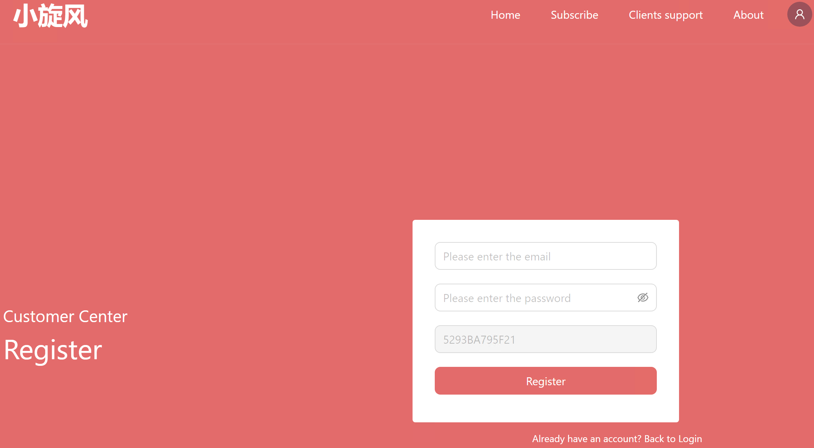](assets/review-images/0f54318f890ace6f-original.png)

###  套餐详情介绍
| 套餐 | 价格 | 时长 | 每月流量 | 速率 | 设备限制 | 其他特点 |
|------|------|------|---------|------|----------|---------|
| **月付** | ¥20.00 | 1个月 | 110GB | 不限速 | 不限制 | AI解锁（ChatGPT、Gemini、Claude），支持抖音直播，解锁Netflix、HBO MAX、Disney等 |
| **季付** | ¥54.00 | 3个月 | 110GB | 不限速 | 不限制 | 同上（海外用户8.5折） |
| **半年付** | ¥102.00 | 6个月 | 110GB | 不限速 | 不限制 | 同上（海外用户8折） |
| **年付** | ¥192.00 | 12个月 | 110GB | 不限速 | 不限制 | 同上 |

[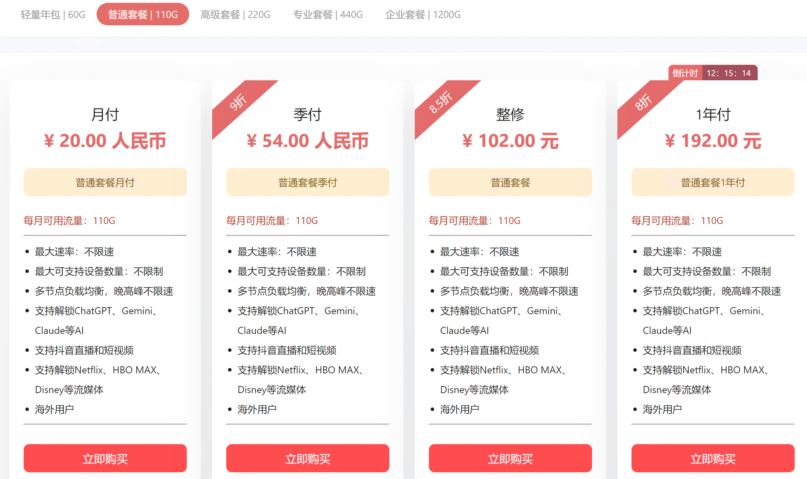](assets/review-images/f3e9128948d14caa-original.png)

------
## 一云梯机场
一云梯提供IPLC线路和原生IP，按1倍率计费，套餐包括周期流量档和定制节点。独享IP或家宽属于定制商品，地址、带宽和使用许可按对应商品区分。
**一云梯特点**
1：IPLC全专线节点，原生IP , 最高速率可达到2000Mbps
2：全节点支持流媒体解锁（包括Netflix , Disney+, HBO等）
3：支持ChatGPT、TikTok短视频运营和直播
4：晚高峰不限速，所有套餐x1倍率
5：可支持企业和个人独享IP和家宽定制
6：真人客服实时在线，可远程协助新手用户完成配置
7：海外团队运营

👉 **[一云梯机场官网注册入口](https://so.dianlanla.com/yiyunti)**

###  套餐详情介绍

| **套餐名称** | **价格** | **时长** | **每月流量** | **特点** |
|-------------|---------|---------|-----------|---------|
| **小年包（推荐）** | ¥98 | 1年 | 60GB | **年付折扣**，适合轻量用户 |
| **VIP1** | ¥15 | 1个月 | 100GB | 适合一般用户，**不限客户端** |
| **VIP2** | ¥30 | 1个月 | 200GB | 适合流媒体 & AI工具使用 |
| **VIP3** | ¥60 | 1个月 | 400GB | **大流量用户**，支持ChatGPT & TikTok |
| **VIP4** | ¥120 | 1个月 | 1000GB | **超大流量套餐**，适合重度用户 |
| **个性化定制** | ¥600 | 1个月 | **定制** | **独享IP & 带宽**，适合TikTok直播 & 跨境电商 |

 **推荐建议**
- **预算有限，轻量使用（浏览网页 & 低流量需求）** → **小年包 ¥98/年（每月60G）**
- **一般使用（流媒体、AI、ChatGPT）** → **VIP1 ¥15/月（100G）**
- **流媒体 & AI 爱好者（4K视频、短视频、聊天机器人）** → **VIP2 ¥30/月（200G）**
- **大流量用户（高频率流媒体 & TikTok直播）** → **VIP3 ¥60/月（400G）**
- **每月1000GB用量** → **VIP4 ¥120/月（1000G）**
- **定制服务（跨境电商、直播业务）** → **个性化定制 ¥600/月**

选档时把流量、付款周期与需要的节点地区一起比较。
[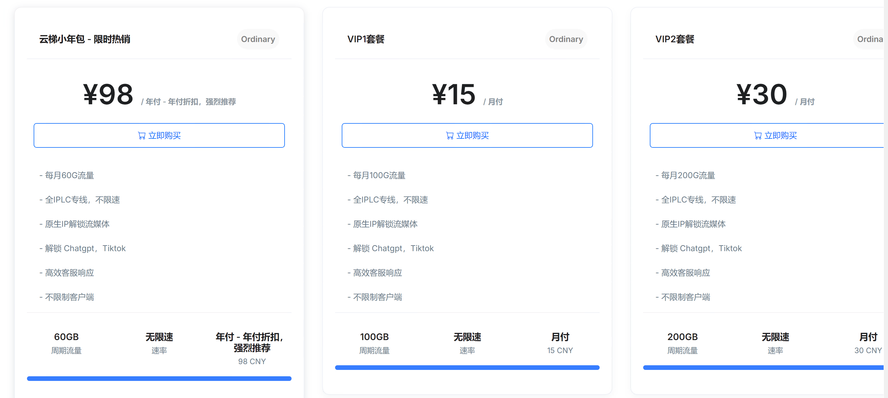](assets/review-images/5d5ba5c2f41f5416-original.png)

------
## Gatern机场

Gatern（原 Shuttle）是一家提供双线并发负载的节点服务，专注于高质量中继与内网专线线路，采用 Vmess 协议传输，提供多个地区的中转与专线节点。支持多种支付方式，包括主流加密货币，满足全球用户需求。

平台提供**流量按需计费型套餐**，有效期最长一年，预先购买总量，用完后停止使用该包，具体套餐详情可访问官网查看。

服务器节点分布全球，涵盖地区包括：  
亚洲：香港、台湾、日本、韩国、新加坡、马来西亚、菲律宾、印尼、印度、泰国、越南、巴基斯坦、以色列、哈萨克斯坦、阿联酋  
大洋洲：澳大利亚、新西兰  
美洲：美国、加拿大、墨西哥、阿根廷、巴西  
欧洲：英国、法国、德国、意大利、荷兰、瑞典、俄罗斯、乌克兰、土耳其、波兰、丹麦、立陶宛、拉脱维亚、瑞士、罗马尼亚  
非洲：埃及、南非等地，可按实际需要的出口地区选择。

- [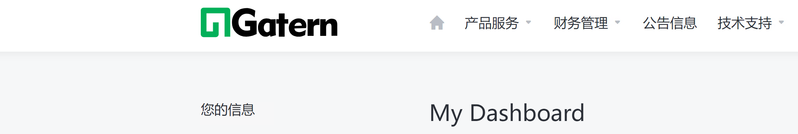](assets/review-images/7039e53b1cebc224-original.png)

**优惠码**
下表按套餐原价比较；年付、短周期与一次性套餐的活动条件分别查看。
套餐详情介绍

🌐 **支持的节点地区（所有套餐均可用）：**
> 香港、台湾、日本、韩国、新加坡、马来西亚、菲律宾、印尼、印度、泰国、越南、以色列、阿联酋、澳新、美加、英法德意等 40+ 国家和地区，小众国家如乌克兰、尼日利亚等也覆盖。

 ###  ⏱ **周期性套餐（按月订阅）**

| 套餐名称 | 月价   | 每月流量 | 年总流量 | 按月续费一年成本 | 单G价格（按月续费一年） |
|----------|--------|----------|----------|----------|---------------------|
| **Nano**  | ¥24    | 120G     | 1440G    | ¥288     | ¥0.20 / GB          |
| **Micro** | ¥40    | 200G     | 2400G    | ¥480     | ¥0.20 / GB          |
| **Small** | ¥76    | 380G     | 4560G    | ¥912     | ¥0.20 / GB          |
| **Medium**| ¥148   | 740G     | 8880G    | ¥1776    | ¥0.20 / GB          |
| **Large** | ¥292   | 1460G    | 17520G   | ¥3504    | ¥0.20 / GB          |

📝 特点：
- 每月固定流量重置
- 适合长期使用且月月都有稳定需求的用户
- 支持最多 10 个设备同时在线
- 统一使用企业级跨境专线 + 支持小众节点

### 🎁 **一次性套餐（买断流量，一年内用完即可）**

| 套餐名称 | 价格   | 总流量 | 使用期限   | 单G价格 |
|----------|--------|--------|------------|---------|
| **Lite**  | ¥188   | 282G   | 有效期1年，表内总量用完为止 | ¥0.67 / GB |
| **Pro**   | ¥388   | 582G   | 有效期1年，表内总量用完为止 | ¥0.67 / GB |
| **Ultra** | ¥788   | 1182G  | 有效期1年，表内总量用完为止 | ¥0.67 / GB |

📝 特点：
- 流量灵活使用，不按月分配
- 适合偶尔使用但希望有预留流量的用户
- 总体比月付贵一些，但适合非连续需求者

🔍 **选择建议（按使用需求）**

| 使用类型                 | 推荐套餐     | 理由                                   |
|--------------------------|--------------|----------------------------------------|
| 日常轻量 / 聊天 / 视频   | Lite 或 Nano | 成本低，满足轻量上网 + ChatGPT 解锁等 |
| 视频多 + 不想月月续费    | Pro / Ultra  | 有效期一年，总量用完为止，按预期消耗选择        |
| 高流量 / 本人多设备 | Medium / Large | 按月流量与标称上限选择，设备共享另核条款                |
| 预算有限、希望按月付款   | Micro / Small | 按月续费，可减少一次预付金额     |

------
## 速鹰666机场
速鹰666机场是一家专业的SSR/V2Ray机场服务提供商，提供多档流量与设备上限的套餐。

主要特点：
- **线路类型**：采用CN2／BGP中转与IPLC内网专线，按所选套餐开放范围使用。
- **支持协议**：支持SSR和V2Ray协议，适合不同用户的需求。
- **流量和设备支持**：下表五档最高为1200GB/月、10台同时在线。另有旧介绍提到16台，但未找到对应商品，不能按16台规划这五档。
- **流媒体解锁**：付费节点可解锁Netflix、Hulu、HBO等国外流媒体。
- **性价比高**：提供灵活的套餐选择，价格便宜，适合不同类型用户。
- **客户端支持**：支持主流SSR/V2Ray客户端订阅链接。
- **服务支持**：提供工单和在线客服，具体入口从已保存的官网查看。

 **优惠码**
表中价格未扣优惠，实际折扣见结算页。

### 套餐详情介绍

| **套餐名称** | **价格** | **流量** | **设备数** | **速率** | **适用人群** |
|-------------|---------|----------|------------|------------|--------------|
| **入门版** | ¥19.99/月 | 100GB | 2台 | 最高60Mbps | **轻度用户** |
| **基础版** | ¥29.99/月 | 200GB | 3台 | 最高150Mbps | **普通流媒体用户** |
| **标准版** | ¥39.99/月 | 350GB | 5台 | 最高300Mbps | **适合高质量流媒体** |
| **旗舰版** | ¥59.99/月 | 600GB | 8台 | 不限速 | **本人多设备，按8台上限** |
| **旗舰版大流量** | ¥99.99/月 | 1200GB | 10台 | 不限速 | **适合高需求用户** |
 **推荐选择**
- **轻度使用（基本网页浏览 + 偶尔视频）** → **入门版（¥19.99/月, 100GB）**
- **日常流媒体（1080P视频）** → **基础版（¥29.99/月, 200GB）**
- **高清流媒体/AI（4K视频 + ChatGPT）** → **标准版（¥39.99/月, 350GB）**
- **600GB/月与对应设备上限** → **旗舰版（¥59.99/月, 600GB）**
- **1200GB/月的大流量需求** → **旗舰版大流量（¥99.99/月, 1200GB）**
[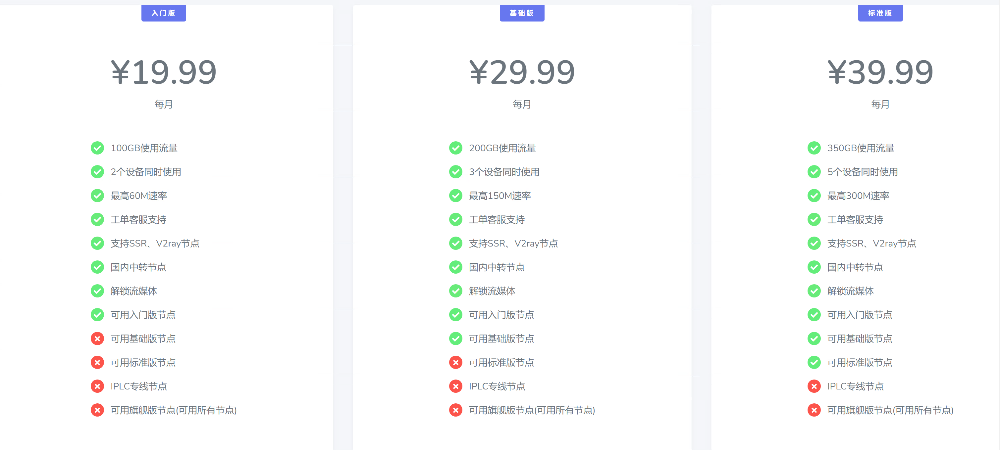](assets/review-images/aeba3630f871c9c9-original.png)

------
## 一枝红杏机场
一枝红杏提供Trojan Lite和Trojan Pro等套餐，节点覆盖美国、日本、台湾、香港、新加坡等地区，支持Netflix、HBO Max、Amazon Prime Video、Disney Now、Disney+等流媒体及ChatGPT。订阅可导入Clash、[Quantumult X](https://github.com/John19187/proxy-client-guides/blob/main/downloads/quantumult-x/README.md#import)等通用客户端，支付方式支持支付宝和微信。使用代理后，目标网站看到的是节点出口IP；日志记录范围和账号使用条件见本家政策。

[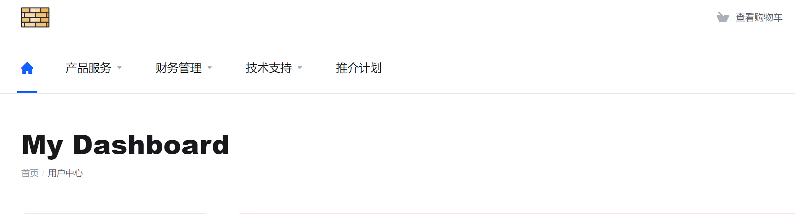](assets/review-images/874686ae5e69a936-original.png)

###  套餐详情介绍
下面比较**Trojan Lite与Trojan Pro**的价格、额度和设备条件：

| **套餐名称**   | **价格（年付）** | **月流量** | **速率**        | **设备数量**     | **其他优势**               | **适合人群**            |
|--------------|----------------|-----------|----------------|------------------|---------------------------|---------------------|
| **Trojan Lite** | ¥99             | 100GB     | 1000 Mbps 高速 | 限 5 台设备         | 全球多线路、流媒体解锁、节点自动更新 | 轻度使用、单人日常上网 |
| **Trojan Pro**  | ¥499            | 500GB     | 1000 Mbps 高速 | 不限设备数量        | 同上，更大流量             | 每月500GB，设备条件按本档条款 |

🎯 推荐建议：

- 🧍‍♂️ **你是轻量用户/自己用** → 按自己的用量比较**Trojan Lite ¥99/年**的额度
- 👨‍👩‍👧‍👦 **本人多设备或每月500GB用量** → 选 **Trojan Pro ¥499/年**，先确认本家共享条款

两者都具备：

- ✅ 1000 Mbps 高速节点  
- ✅ 全球多线路支持  
- ✅ 解锁 Netflix、Disney+、YouTube Premium 等  
- ✅ 云端自动订阅更新，免手动设置
Lite与Pro分别按流量和设备条件比较；家人共用还要有相应共享许可，不从设备不限推定。

[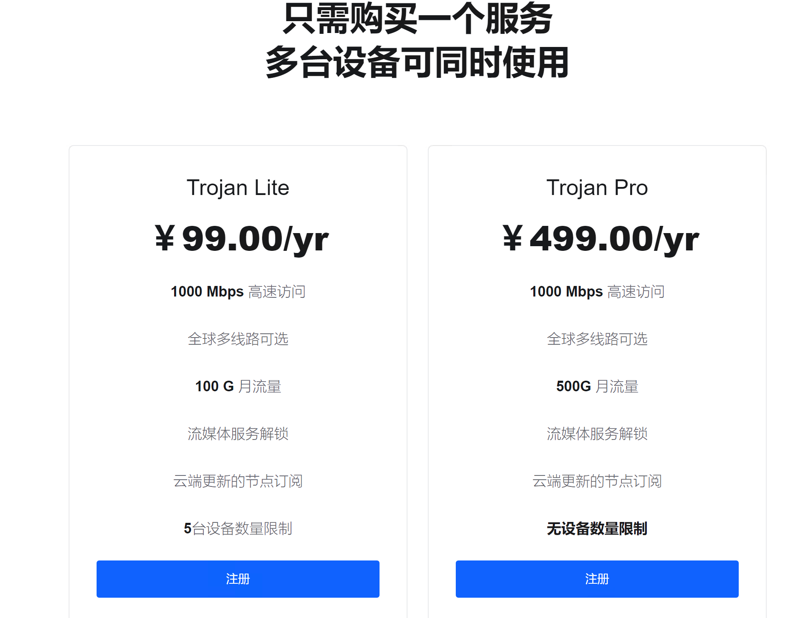](assets/review-images/23bc71ac64fddd44-original.png)

------
## BoostNet机场
BoostNet按月流量和设备数分档，另有轻量年付。小流量档与大容量档的重置费用不同，选择时同时算套餐价和可能需要的重置支出。

[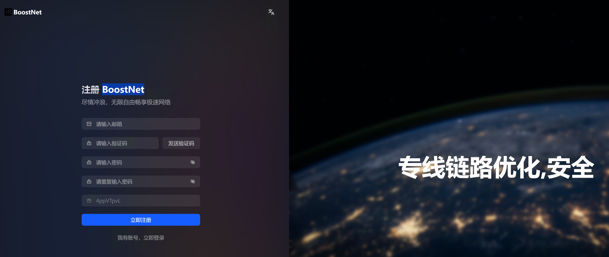](assets/review-images/2f8e726baf032e86-original.png)
全站“新人必看”公告写明屏蔽BT／P2P／PT相关网站。具体下载用途先核对这一条款，不把它当作所有BT传输的同义词。

###  价格与付款条件
表中价格未扣优惠，实际折扣见结算页。
###  套餐详情介绍

| 套餐名称 | 价格 | 时长 | 每月流量 | 设备支持 | 其他特点 |
|----------|------|------|---------|----------|---------|
| **爆款套餐** | ¥39 | 1个月 | 200GB | 5台 | 支持流媒体（Netflix/GPT/Disney+），全站条款屏蔽BT/P2P/PT相关网站 |
| **轻量套餐** | ¥20 | 1个月 | 20GB | 5台 | 适合轻度使用，支持流媒体，手动流量重置 ¥10/20GB |
| **轻量套餐（年付）** | ¥118 | 12个月 | 20GB/月 | 5台 | 年付优惠方案 |
| **大流量套餐** | ¥58 | 1个月 | 400GB | 5台 | 适合流媒体爱好者，手动流量重置 ¥60/400GB |
| **超大流量套餐** | ¥108 | 1个月 | 1000GB | 5台 | 适合重量级用户，手动流量重置 ¥110/1000GB |
| **至尊VIP套餐** | ¥388 | 1个月 | 1500GB | 30台 | 支持30台设备，使用许可按本档条款，手动流量重置 ¥388/1500GB |

**推荐建议**
- **轻量用户**（偶尔上网、少量流媒体）：轻量套餐 ¥20/月
- **一般用户**（经常刷短视频和流媒体）：爆款套餐 ¥39/月
- **流媒体重度用户**（4K/8K观看、下载）：大流量套餐 ¥58/月
- **超高需求用户**（大量流量需求）：超大流量套餐 ¥108/月
- **需要30台设备条件**：至尊VIP套餐 ¥388/月

------
## 悠兔机场

悠兔的旧版价格按每月流量分档，50GB至1000GB各有不同付款周期。下表留作历史订单对照，当前套餐与设备条件从服务商自己的商品页查看。

###  套餐详情介绍

| 流量 | 月付 | 季付 | 半年付 | 年付 |
|------|------|------|--------|------|
| **50GB/月** | ¥29 | ¥55 | ¥110 | ¥200 |
| **150GB/月** | ¥29 | ¥85 | ¥160 | ¥300 |
| **300GB/月** | ¥39 | ¥110 | ¥210 | ¥400 |
| **500GB/月** | ¥59 | ¥160 | ¥310 | ¥500 |
| **1000GB/月** | ¥100 | ¥280 | ¥520 | ¥1000 |

------
## 掌中世界机场

掌中世界机场高价购入IPLC内网专线，提供多个套餐档位。原介绍的加密与流量混淆用于传输，实际连接仍受入口、节点与当前网络影响

**优惠码**
表中价格未扣优惠，实际折扣见结算页。

👉 **[掌中世界机场官网注册入口](https://so.dianlanla.com/zhangzhong)**

###  套餐详情介绍

| **套餐名称** | **价格** | **流量** | **设备数** | **带宽** | **适用人群** |
|-------------|---------|----------|------------|------------|--------------|
| **BA1.0 小号** | ¥18/月 | 100GB/月 | 2台 | 500Mbps | **轻度用户** |
| **ST2.0 中号** | ¥20/月 | 280GB/月 | 3台 | 500Mbps | **适合流媒体/AI工具** |
| **PR5 火力全开** | ¥45/月 | 680GB/月 | 6台 | 不限速 | **高流量需求** |
| **mini X** | ¥78/年 | 30GB/月 | 2台 | 300Mbps | **极轻度用户** |
| **mini S** | ¥88/年 | 60GB/月 | 2台 | 300Mbps | **轻度用户** |
| **king** | ¥299/两年 | 2088GB/2年 | 6台 | 不限速 | **两年总量2088GB** |
| **限量传家宝** | ¥399/一次 | 5550GB/无期限 | 10台 | 不限速 | **超长期备用流量** |

 **推荐选择**
- **轻度使用（仅日常浏览）** → **mini S（¥88/年, 60GB/月）**
- **中等需求（流媒体/AI）** → **ST2.0 中号（¥20/月, 280GB/月）**
- **高流量需求（高清流媒体/大规模下载）** → **PR5 火力全开（¥45/月, 680GB/月）**
- **长期使用，省心不续费** → **king（¥299/两年, 2088GB）**
- **终极备用流量，无时间限制** → **限量传家宝（¥399/一次, 5550GB）**

[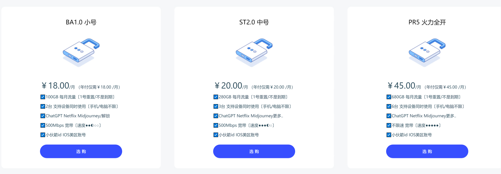](assets/review-images/2685b4fb68f910a3-original.png)

## WestData西部数据机场

**WestData 西部数据机场** 成立于 2021 年，专注于提供稳定、高效的科学上网服务。平台所有节点均采用 **Trojan 协议**，使用TLS传输，另提供 **中国大陆 BGP 多线接入**，按自己的运营商选择入口。配备国际 **IPLC 传输线路**，可选择相应地区的出口。

WestData 提供丰富的流媒体解锁服务，支持访问多种热门平台（如 **Netflix、Hulu、HBO** 等），并提供 **ChatGPT 解锁**，打破地域限制，畅享全球互联网资源。

💡 **WestData 服务特点**：

- **Trojan协议**：节点使用Trojan，客户端需取得对应订阅  
- **BGP 多线接入 + 国际 IPLC 线路**：按常用节点与所在运营商比较连接体验
- **平台支持**：Netflix、Hulu、HBO等流媒体与ChatGPT
- **价格实惠**：最便宜套餐仅需 **￥20/月**  
- **套餐差异**：速率与配额按档位配对；800GiB档标称2000Mbps，500Mbps属于另一档  
- **支付方式**：支持支付宝与 USDT，方便快捷

[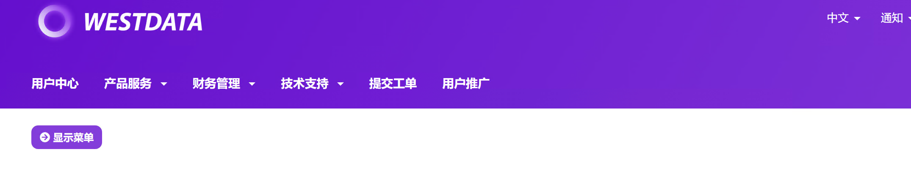](assets/review-images/4486f3791ceeab8a-original.png)

### 🧾 PASS 套餐详细对比

| 套餐名称     | 月付价格 | 月流量 | 峰值速率       | 技术支持     | 使用说明           |
| ------------ | -------- | ------ | -------------- | ------------ | ------------------ |
| **SILVER**   | ¥20/月   | 200GiB | 最高 500 Mbps  | 有限基础支持 | 个人使用，暂不退款 |
| **PLATINUM** | ¥40/月   | 400GiB | 最高 500 Mbps  | 有限基础支持 | 个人使用，暂不退款 |
| **DIAMOND**  | ¥60/月   | 600GiB | 最高 1000 Mbps | 专属技术支持 | 个人使用，暂不退款 |
| **ULTIMATE** | ¥80/月   | 800GiB | 最高 2000 Mbps | 专属技术支持 | 个人使用，暂不退款 |

 🔧 **共有功能特点：**

- 🇨🇳 **中国大陆 BGP 多线接入**
- 🌏 **国际 IPLC 专线传输**
- 📺 **解锁流媒体服务（Netflix、Disney+等）**
- 🤖 **ChatGPT 解锁支持**
- 🔐 节点使用Trojan与IPLC线路
- 🧍‍♂️ **仅限个人使用、不支持退款**

🎯 **选购建议：**

| 你的使用习惯           | 推荐套餐            |
| ---------------------- | ------------------- |
| 偶尔使用，轻量流量需求 | **SILVER ¥20/月**   |
| 稍频繁看片/上网        | **PLATINUM ¥40/月** |
| 日常追剧+打游戏        | **DIAMOND ¥60/月**  |
| 多设备+重度使用        | **ULTIMATE ¥80/月** |

------
------
## 速云梯机场

速云梯机场主要提供SSR和V2ray协议节点，使用国内中转和IPLC内网专线。入门、基础、标准和旗舰等套餐的流量、设备支持不同，可按实际用量与客户端需求选择；节点倍率和当前维护情况也应一并比较。

👉 **[速云梯机场官网注册入口](https://so.dianlanla.com/suyunti)**

[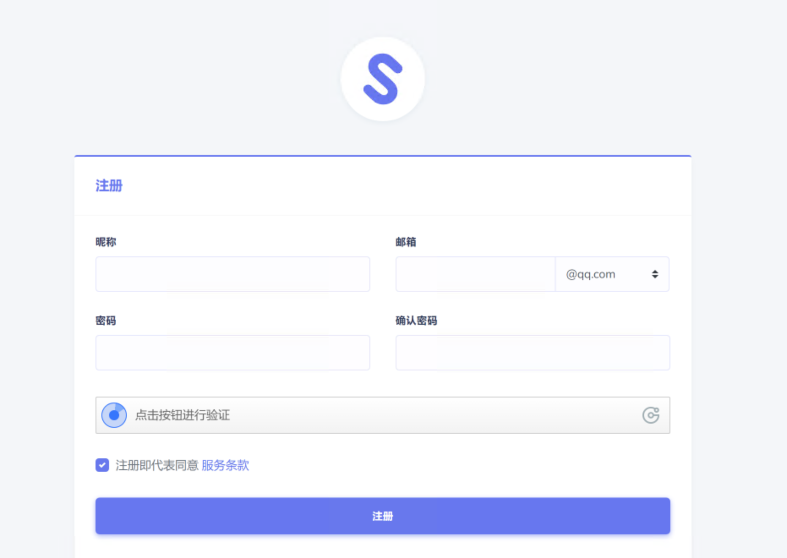](assets/review-images/fb40c2fd07932f49-original.png)

------

### 套餐详情介绍
|套餐|入门版|基础版|标准版|旗舰版|旗舰版大流量|
|----|----|----|----|----|----|
|月付|￥19.9|￥29.9|￥39.9|￥59.99|￥99.99|
|季付|￥59.97|￥89.97|￥119.97|￥179.97|￥299.97|
|半年付|￥119.94|￥179.94|￥239.94|￥359.94|￥599.94|
|年付|￥239.88|￥359.88|￥479.88|￥719.88|￥1199.88|
|两年付|￥479.76|￥719.76|￥959.76|￥1439.76|￥2303.76|

套餐区别：

|入门版|基础版|标准版|旗舰版|旗舰版大流量|
|----|----|----|----|----|
|100GB使用流量 2个设备同时使用 最高60M速率 工单客服支持 支持SSR、V2ray节点 国内中转节点 解锁流媒体 可用入门版节点|200GB使用流量 3个设备同时使用 最高150M速率 工单客服支持 支持SSR、V2ray节点 国内中转节点 解锁流媒体 可用入门版节点 可用基础版节点|350GB使用流量 5个设备同时使用 最高300M速率 工单客服支持 支持SSR、V2ray节点 国内中转节点 解锁流媒体 可用入门版节点 可用基础版节点 可用标准版节点|600GB使用流量 8个设备同时使用 不限制速率 Telegram客服技术支持 支持SSR、V2ray节点 国内中转节点 解锁流媒体 可用入门版节点 可用基础版节点 可用标准版节点 IPLC专线节点 可用旗舰版节点(可用所有节点)|1200GB使用流量 10个设备同时使用 不限制速率 Telegram客服技术支持 支持SSR、V2ray节点 国内中转节点 解锁流媒体 可用入门版节点 可用基础版节点 可用标准版节点 IPLC专线节点 可用旗舰版节点(可用所有节点)|

## MESL机场

MESL 的普通 Premium 套餐允许 5 台设备同时在线。2026 年 11 月套餐页标示 BGP、IPLC、IEPL 专线中继及最高 10 Gbps 带宽。想知道家里晚上看视频是否流畅，单看标称带宽还不够。

MESL 在 9 月 23 日公告中推荐使用官方客户端。它的分流依赖专用 DNS。用 [Shadowrocket](https://github.com/John19187/proxy-client-guides/blob/main/downloads/shadowrocket/README.md#import)，要先载入 MESL 的分流配置，再更新订阅；用 Clash 时，检查自己的 [DNS覆写是否盖掉了这份配置](https://github.com/John19187/proxy-client-guides#campus-dns)。[v2rayN](https://github.com/John19187/proxy-client-guides/blob/main/downloads/v2rayn/README.md#import) 无法按同一方式接收这套 DNS。准备先试用的读者，应在付款前查看账户里是否有试用入口。

👉 **[MESL机场官网注册入口](https://so.dianlanla.com/mesl)**

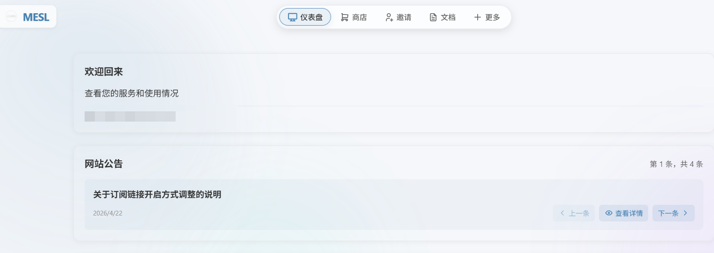

### 套餐价格表

下表为 2026 年 11 月 4 日套餐页的人民币价格，每格是该周期一次要付的总额。普通 Premium 档在每月账单日重置流量，空缺的周期用「—」标出。

| 套餐 | 每月额度 | 月付 | 季付 | 半年付 | 年付 | 流量重置费 | 同时在线设备 |
| --- | ---: | ---: | ---: | ---: | ---: | ---: | ---: |
| Premium 50G | 50GB | — | — | — | ¥155 | ¥15 | 5台 |
| Premium 100G | 100GB | — | ¥72 | ¥142 | ¥256 | ¥26 | 5台 |
| Premium 200G | 200GB | ¥50 | ¥140 | ¥256 | ¥499 | ¥50 | 5台 |
| Premium 300G | 300GB | ¥70 | ¥205 | ¥380 | ¥760 | ¥70 | 5台 |
| Premium 500G | 500GB | ¥110 | ¥320 | ¥630 | ¥1200 | ¥110 | 5台 |
| Premium 1024G | 1024GB | ¥210 | ¥610 | ¥1200 | ¥2299 | ¥210 | 5台 |
| Premium Team | 3072GB | ¥599 | ¥1699 | ¥3299 | ¥6300 | ¥599 | 20台 |

100G档的¥26是流量重置费；季付¥72折合每月¥24，下单仍需一次付¥72。国际站与人民币账户的商品可能不同，本表仅比较这份人民币套餐记录，国际站商品另按对应商店查看。站方另列新疆优化专属套餐并提示其他地区用户勿购，不与上表混为同一档位。

**选购建议**

- 每月约100GB用量：比较Premium 100G的季付、半年付与年付，注意首次应付总额。
- 需要单月付款：从已列月付的Premium 200G及以上档位比较，普通档均为5台同时在线。
- 需要更多设备：Team档允许20台同时在线，每月3072GB；一起比较设备数、月用量与总价。

购买前核对所在网络的客户端适配、当期可购项与退款条件；带宽标称和流媒体清单不保证每个节点在你的网络上都能达到相同效果。

## Bitz Net机场

### Bitz三个档位怎么比较（资料日期：2026-09-15）

| 档位 | 季付 | 半年付 | 年付 | 两年付 | 三年付 | 每月流量 |
|---|---:|---:|---:|---:|---:|---:|
| 边缘访问 | ¥69.99 | ¥124.99 | ¥244.99 | ¥444.99 | ¥569.99 | 80GB |
| 核心访问 | ¥119.99 | ¥229.99 | ¥429.99 | ¥764.99 | ¥999.99 | 400GB |
| 深度访问 | ¥199.99 | ¥379.99 | ¥714.99 | ¥1274.99 | ¥1664.99 | 1000GB |

三档均没有单独月付。边缘访问明确不包含香港、日本等亚太节点，节点清单与核心访问分别查看；最低价也需连地区范围一起看。手动重置费分别¥16.99、¥34.99、¥54.99，不是套餐起购价。三档标称峰值分别为100/500/800Mbps。

Bitz第三方订阅先在官网用户首页点“激活订阅”，完成人机验证后再次点击，选择“复制订阅地址”。本家2026年5月19日公告写激活后有10分钟下载窗口；过期后地址不变、已导入节点仍可用，下次更新前再激活。

[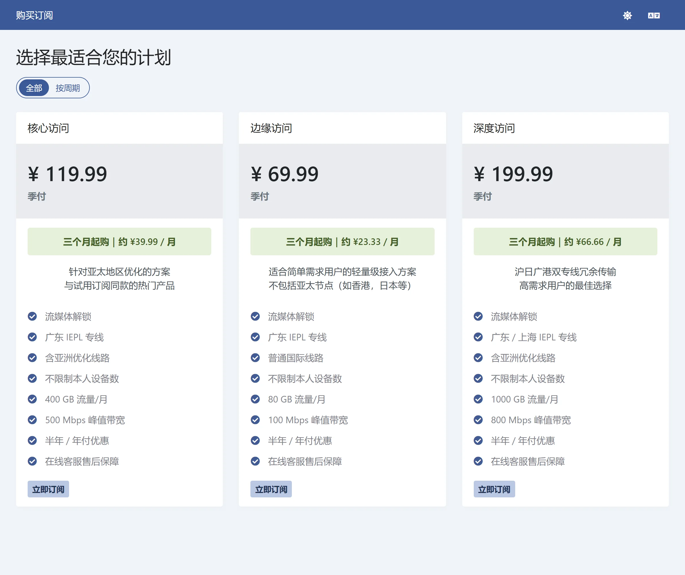](assets/review-images/ddf5bd8718f78ea9-original.webp)

Bitz Net 的三档套餐可以先按每月流量和最低付款金额比较。以下价格来自 2026 年 9 月 15 日的官网套餐页记录，三档均从季付起购；表中的折合月费不是可单独购买的月付价格。

| 套餐 | 季付总价 | 折合月费 | 每月流量 | 标示峰值带宽 |
|---|---:|---:|---:|---:|
| 边缘访问 | ¥69.99 | 约 ¥23.33 | 80 GB | 100 Mbps |
| 核心访问 | ¥119.99 | 约 ¥39.99 | 400 GB | 500 Mbps |
| 深度访问 | ¥199.99 | 约 ¥66.66 | 1000 GB | 800 Mbps |

各档套餐的标称峰值带宽不同。官网还提供其他付款周期，实际价格和可购买状态以页面为准。

👉 **[Bitz Net 官网注册入口](https://so.dianlanla.com/bitznet)**

## 蓝帆云

蓝帆云的套餐按流量、同时使用设备数和节点等级分档。看价格之外，还要看自己买到哪一级节点：入门版只能使用入门节点，基础版增加基础节点，标准版再增加标准节点。

👉 **[蓝帆云官网注册入口](https://so.dianlanla.com/lanfanyun)**

### 套餐价格与节点等级

三档月付套餐的价格、流量和节点等级如下。

| 套餐 | 月付价格 | 页面流量额度 | 同时使用设备 | 标称最高速率 | 可用节点等级 |
|---|---:|---:|---:|---:|---|
| 入门版 | ¥12.99 | 50GB | 2台 | 60M | 入门版 |
| 基础版 | ¥17.99 | 100GB | 2台 | 60M | 入门版、基础版 |
| 标准版 | ¥32.99 | 200GB | 3台 | 150M | 入门版、基础版、标准版 |

表中月付档的流量一次到账，到期清零；其他付款周期的到账与重置方式需另行确认。更换套餐需从首页的升级套餐入口操作。表中为月付选项，其他付款周期与更高档位可在商店中比较。

[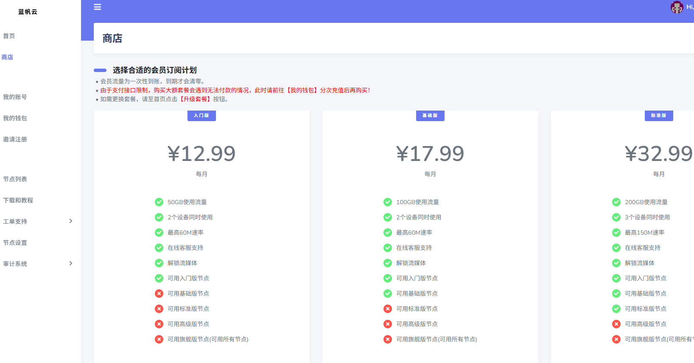](assets/review-images/636ace2be7493446-original.png)

蓝帆云还提供在线客服与流媒体节点服务。选购时可结合节点地区、设备数及套餐等级比较，客户端配置与退款条件见官网说明。

## 秒连云机场

月度常用流量和偶尔使用的备用流量，可以分开安排。秒连云同时提供月付套餐与一次性付费的不限时流量包：Air 120G月付8元；120G不限时流量包一次性38元。前者按月提供额度，后者按流量使用，可以按自己的使用频率比较固定月费与总量包的花费。

👉 **[秒连云官网注册入口](https://so.dianlanla.com/owner-ap0089)**

### 月付及年付套餐

以下价格信息截至2026年11月。表中各周期价格为该周期应付总额，流量列为每月额度；“—”表示未列出该周期价格。

| 套餐 | 每月流量 | 月付 | 季付 | 半年付 | 年付 | 两年付 | 流量重置费 |
|---|---:|---:|---:|---:|---:|---:|---:|
| 150G/月 年付活动 | 150G | — | — | — | ¥118 | — | ¥10 |
| 220G/月 年付活动 | 220G | — | — | — | ¥168 | — | ¥12 |
| Air 120G | 120G | ¥8 | ¥24 | ¥48 | ¥96 | ¥192 | ¥7 |
| Base 220G | 220G | ¥15 | ¥45 | ¥90 | ¥180 | ¥360 | ¥12 |
| Pro 320G | 320G | ¥22 | ¥66 | ¥132 | ¥262 | ¥520 | ¥18 |
| Max 520G | 520G | ¥28 | ¥82 | ¥162 | ¥320 | ¥638 | ¥23 |

### 不限时流量套餐

| 套餐 | 总流量 | 一次性价格 |
|---|---:|---:|
| 120G不限时 | 120G | ¥38 |
| 320G不限时 | 320G | ¥78 |
| 980G不限时 | 980G | ¥198 |

不限时套餐的额度是整包总流量，不是每月重新发放。Air 120G适合按月安排固定流量；120G不限时包可供低频使用或备用连接比较，不需要把整包额度在一个月内用完。更大总量包则要结合使用频率和首次付款金额选择，实际可购项以官网为准。

秒连云提供全中转加密线路，支持流媒体与GPT。付款前向秒连云客服确认所选套餐的同时在线设备数和完整速率单位。

### 客户端与购买条件

秒连云在 4 月 15 日的公告中提醒，部分旧客户端不支持 AnyTLS，可能出现节点超时。已经有订阅的用户，先看手里的客户端是否支持该协议，再按[更新订阅与升级软件的区别](https://github.com/John19187/proxy-client-guides#update)决定是否升级。

**官网明确不提供退款服务，并提示新疆地区用户不要购买。** 付款前一并确认客户端适配和当前套餐条件；入口变化与维护信息可关注[官方Telegram群组](https://t.me/miaolianyun)。

## 机场套餐横向比较

下表集中比较稳定性价比机场、WgetCloud、杨帆云和泰山。先看首次实付与配额周期，再按客户端路线和节点等级选择；资料日期及完整条件保留在各品牌正文，年价除以12只是月均费用。

| 机场（完整介绍） | 首次付款例 | 付款周期与流量 | 线路与地区 | 客户端或设备 | 选购要点 |
|---|---|---|---|---|---|
| [**稳定机场**](#稳定性价比机场) | ¥18/月，100GB | 月付¥18/100GB、¥38/300GB、¥53.60/500GB；年付¥76/50GB月、¥116/100GB月、¥146/150GB月 | 企业级跨境专线 | 本家专属客户端 | 仅官方客户端，不提供第三方订阅 |
| [WgetCloud机场](#wgetcloud机场) | 新购季付/年付，应付金额见商店 | 新购季付230/250/270G每30天；年付280/320/360G每30天 | 多线BGP+CN2 | 3/4/5个可用IP，非设备数；Trojan订阅 | 旧月付规格见本节；新购比较商店应付金额 |
| [杨帆云机场](#杨帆云机场) | ¥19.99/月，LV1 | 100/200/400/700/1200GB月档 | 节点按等级开放，LV1国内中转 | UniClash；2—6台按档位 | 低档位不含全部IEPL线路 |
| [Taishan Net泰山](#taishan-net-泰山机场) | ¥13/月，128GB；64GB档¥29/季 | ¥29/季含每月64GB；¥13/月含128GB；一次性¥78含总量200GB | 按当前套餐核对 | 见本家教程 | 总量包不按月重发；所选节点可能有倍率 |

## 按月付、季付与按量需求比较机场

### 先比较一次实际付多少钱

| 需求 | 有日期的套餐例子 | 首次实付 | 容易看错的地方 |
|---|---|---:|---|
| 只买一个月 | 泰山128GB/月（9月7日记录） | ¥13 | 与64GB季付档不同 |
| 100GB左右月用量 | 稳定机场轻量100GB/月（11月5日资料） | ¥18 | 同时登录3台，使用本家专属客户端 |
| 按客户端和节点等级选档 | 杨帆云LV1 | ¥19.99/月 | 100GB/月、2台设备，节点按等级开放 |
| 可接受季付 | 泰山64GB/月（9月7日记录） | ¥29/季 | ¥29为一次季付总额，月均约¥9.67 |
| 比较季付、年付和节点等级 | WgetCloud基础、优质、精品 | 按本人商店当前应付金额 | 不同付款周期的每30天配额不同，可用IP数不是设备数 |
| 间歇使用 | 泰山总量200GB（9月7日记录） | ¥78 | 总量包不每月重新发放 |

用这些例子对照付款周期与配额。付款前同时看应付总额、流量重置、节点范围和客户端要求。

### 月付、季付、年付：月均价和实际支出分开看

月付按一个计费周期的需求选择，季付和年付则一起比较首次支出与每期额度。例如泰山64GB档季付¥29，下单仍需支付¥29；稳定机场年付¥116对应每月100GB，与月付¥18/100GB按各自周期比较。WgetCloud季付、年付的每30天配额不同，杨帆云还需按套餐等级核对设备数和节点范围。

### 按量付费与不限时流量：先看总量和有效期

按量包买的是一份逐步消耗的总流量，不是每月重新发放的配额。下面以本帖重点介绍的服务说明选择方法，产品名称相近也要分别看有效期、倍率和到期处理。

| 使用方式 | 重点比较 | 对应选择 |
|---|---|---|
| 每天查资料、聊天或看视频 | 每月用量、重置时间与客户端 | 稳定机场的月付/年付档，或按等级选择杨帆云 |
| 已有第三方客户端 | 所需订阅格式、付款周期与节点等级 | WgetCloud对应套餐 |
| 一个月只用几天或保留备用流量 | 总量、有效期与节点倍率 | 泰山200GB/¥78、600GB/¥195总量包，按所选产品条件购买 |

按量成本可以用“应付金额÷总流量”比较，例如200GB/¥78约为¥0.39/GB。计算时按所用节点倍率扣量，再结合视频、下载等实际用途估算。

## 机场选购常见问题

### 100GB和300GB流量怎么选？

按30天使用周期计算，100GB平均每天约3.3GB，300GB平均每天约10GB。可以先看自己最近一个完整周期的实际用量，再加上预计新增的视频、下载和其他设备用量；流量倍率和重置时间也会改变结果。

视频流量可按实际平均码率估算：GB约等于“Mbps × 小时 × 0.45”。例如平均8Mbps的视频每小时约3.6GB，100GB约能承担27小时，300GB约83小时；这是十进制单位的算术示例，尚未扣除网页、下载、协议开销或节点倍率，按视频实际平均码率计算。

### IEPL、IPLC与中转线路怎么比较？

IEPL和IPLC是专线类别，中转描述连接通过额外服务器转发；一款服务也可能把专线与中转结合使用。名称只说明线路组织的一部分，选型时还要看你所在运营商到入口的连接、所需地区是否在套餐内、高峰时段表现及流量倍率。

不需要把最贵的专线档当作所有人的起点。WgetCloud各等级开放的地区不同，杨帆云不同等级开放的线路也不同；先找到能访问所需地区、适配自己设备的档位，再比较额度和费用。MESL本家人民币套餐标示BGP+IPLC+IEPL，WgetCloud按套餐等级区分节点与额度，二者仍需按具体规格比较。

### 价格更高就一定更适合吗？

更高价格可能买到更多流量、更高标称限速、更多地区或不同设备限制，未必都是你需要的条件。两台设备的轻量用途与多设备视频用途，可以落在不同档位；需要香港、日本等节点时，也不能为了较低每GB价格买不含这些地区的包。

### “不限流量”“不限时”和“不限速”有什么区别？

不限流量描述配额，不限时描述有效期，不限速描述速率条款，三个词不能互换。还有的不限流量套餐限制设备数，有的流量包允许长期保留却有节点倍率。把配额、有效期、限速、地区和设备数分别核对，比只看一个宣传词更有用。

## 机场连不上了，先分清是哪一种

先在自己可用的另一张网络上比较一次，例如家庭宽带与手机热点。换网后能连，说明问题与原网络到入口的路径或策略有关，接着核对DNS、客户端和服务商公告；不要只凭一次结果就认定是电脑故障或机场停运。

还是不通，按三种情况分。它们的处理方式完全不同，最怕的是把换域名当成跑路，或者把跑路当成临时故障干等着。

**节点不可用，但官网还能打开。** 先检查套餐是否有效、订阅是否更新，再看你所用服务商首页的故障范围与恢复安排，必要时联系客服。主用暂时中断时先切换已经准备好的备用连接。

**订阅更新失败，官网也打不开。** 比较不同网络的访问结果，再查已保存的官方公告和备用入口。其他网络能打开而当前网络打不开，可能涉及DNS、路由或访问限制。遇到入口迁移，使用本家已确认的新地址，不把搜索广告里的同名站点当成备用官网。

**域名无法解析。** 浏览器提示找不到服务器时，核对其他网络及DNS的结果；ping没有回应也可能只是禁止ICMP，并不等于域名没有解析。再查已确认的备用入口、公告及客服。

域名解析失败不等于停运。入口迁移、域名到期和DNS故障都可能造成旧地址无法访问；官网、备用地址、公告和客服的持续失联则需要进一步核实。从已保存的服务入口查看站内公告；若仍能登录，可用工单核实故障范围，并保留报错与发生时间。

### 2026年7月的一次历史入口检查

2026 年 7 月 27 日，我对这份清单收录的 61 条服务商链接做了一次全量可达性核查，6 条访问不到，接近十分之一。失效形态分三类：域名解析不到 4 条、服务器返回 503 一条、连接超时一条。

把这6条逐个追查后的结果是：3 家还在正常运营，只是换了域名；2 家确认已经停运或转手；1 家线索不足，判断不了。

这是当时61条入口链接的检查结果，反映的是链接可达性；其中包含换域名、停运或转手，不能作为机场停运率。

### 钱还能不能追回来

先保存订单、付款记录、服务不可用的截图，以及联系商家的记录，再按原付款渠道处理：

| 付款渠道 | 可以先做什么 |
|---|---|
| 微信支付商家订单 | 在“我 → 服务 → 钱包 → 账单”打开该笔交易，点“对订单有疑惑”，按页面投诉商家；个人转账先联系收款方协商。[官方账单说明](https://pay.weixin.qq.com/doc/user/4021834826) |
| 支付宝 | 在“我的 → 账单”打开交易详情，选择“投诉”，按页面提交材料。[官方举报入口说明](https://110.alipay.com/sc/report.htm) |
| PayPal | 在“调解中心 → 报告问题”选择对应付款，按实际情况提出争议；协商未解决时，在页面规定期限内升级处理。[官方争议说明](https://www.paypal.com/c2/cshelp/article/如何向卖家提出争议？-help160) |
| 信用卡 | 联系卡面或卡背的发卡行客服，说明该笔交易争议，并按要求提交订单和沟通记录。[Visa官方指引](https://usa.visa.com/support.html) |
| 第三方发卡平台 | 从购买平台的原订单联系商家和平台客服，查看这笔订单适用的售后条款。 |
| USDT等加密货币 | 保存交易哈希、收款地址和订单，通过原商家渠道协商。 |

预付周期越长，尚未用完的费用通常越多。比较年付折扣时，也要比较一次支付金额和退款条件；月付或季付可减少单次预付金额，退款与费用追回按支付渠道和订单条款办理。

### 出现哪些情况值得进一步核实

- 已付款后持续无法使用，原公告、工单和备用入口也无法取得说明。先区分已知维护、本地网络与服务侧异常，再保留订单和错误记录。
- 公告停更、客服未回复。查看近期维护安排、节假日受理时间与本家备用联系渠道。
- 入口反复变化，原公告与客服渠道未能说明去向。从已保存的官方渠道核实，不只凭旧域名打不开判断停运。

可在自己设备上保存客户端配置，订阅地址不要公开分享。重要用途提前准备并确认备用连接可用。

日常主用可以侧重常用地区、流量与顺手的客户端，低频使用则可比较总量包和有效期。经常使用AI工具、查阅海外资料或处理工作的人，也可以另备一两条已经确认可用的连接；遇到特殊时期或临时维护，切换起来更从容。专线、中转和不同价位各有适用场景，持续可用仍需要服务商维护，也要结合自己所在网络判断。

选购前核对本家是否提供试用、最短付款周期及退款条件，再比较自己的网络下能否满足用途。此清单按可核验资料更新，明确退役的服务移出推荐，可收藏后定期回看套餐与使用教程。

## 更新日志

展开更新日志

- 2026-11-16　折叠更新记录，收起许可说明，撤下不必要的维护数据与贡献提示入口。 预算与比较区聚焦四家，比较区后移，大哥云正文移到泰山后；其他品牌详情保留。

- 2026-11-16　删除图片后的重复仓库自链，补充文末客户端与免费节点目录；从中转与套餐选择说明持续可用的限制、节点暴露风险及备用安排，保留品牌图文和推广入口。 补充超低价机场的交付、售后、停运与预付款风险。 图片恢复原件展示，撤掉后加的仓库署名条。

- 2026-11-15　把预算、横向套餐、付款周期和客户端选择前置，保留品牌原文图表及入口；具体操作直达各款教程，环境背景沿独立时间线阅读。

- 2026-11-14　整理客户端资料与故障排查，撤下未核实当前条件的旧优惠及第三方测速图；按已收本家人民币资料更正MESL付款周期与流量重置费。
- 2026-11-14　调整推荐清单至40家，同步更新目录及套餐比较表。

- 2026-11-08　补充4月以来及10月下旬会议前后的网络环境，并衔接VPN帖的TCP与校园网DNS问答；调整故障排查，区分本地网络、入口迁移和节点故障。
- 2026-11-08　新增秒连云完整介绍：六款周期套餐、三款不限时总量包、客户端教程、无退款及新疆勿购条件；纳入月付与按量比较，收录数由42家增至43家。
- 2026-11-08　更新杨帆云、老猫云、泰山、大哥云、飞机云、灯塔Cloud和虫洞云的注册入口；保留原有邀请码，杨帆云使用最新指定完整地址，泰山与灯塔同步新入口的路由格式。
- 2026-11-08　按11月5日已收资料更新稳定机场的客户端数量、标称带宽与一次性包标价，统一两帖的套餐字段；年付仍按每月重置解释，较大一次性包的配额口径保留确认条件。
- 2026-11-08　补充稳定机场官网已列的六个优惠码及适用周期，区分两年付公告和特惠套餐页的不同代码；黄金包折扣、截止日与叠加条件未明的保留结算验证说明。
- 2026-11-08　将持续使用与备用连接建议放入结尾，调整部分绝对稳定、安全保证及未确认旧优惠的表述；保留原品牌图文、历史资料日期和更新记录。

- 2026-10-09　新增蓝帆云及套餐原图；调整标题，补预算用途选型、付款周期、按量与客户端选择及购买问答，统一相关套餐口径。

- 2026-09-16　优化标题，补充套餐价格与付款周期比较，加入Bitz并移除退役服务。

- 2026-08-01　新增 MIT 许可证、结构化服务商清单、维护方法与 GitHub Actions 自动校验
- 2026-07-27　全量核查 61 条服务商链接可达性，6 条访问不到；逐条追查后 3 家为更换域名、2 家已停运或转手
- 2026-07-19　稳定机场机场更换官网域名，链接已同步
- 2026-07-07　下架 okanc（疑似停运）
- 2026-06-03　新增 Coffee Cloud 咖啡云
- 2026-06-02　新增 MESL 机场

## 客户端与相关资源目录

按设备和配置类型进入对应教程；旧版条目用于识别与迁移。软件之间的订阅、配置和备份条件仍以各篇说明为准。

展开客户端目录（含旧版与迁移说明）

| 客户端 | 设备或范围 | 教程用途 |
|---|---|---|
| [Clash Verge Rev](https://github.com/John19187/proxy-client-guides/blob/main/downloads/clash-verge-rev/README.md) | Windows／macOS／Linux | Clash／Mihomo配置与系统代理 |
| [FlClash](https://github.com/John19187/proxy-client-guides/blob/main/downloads/flclash/README.md) | 电脑／Android | 跨平台下载、导入与连接 |
| [Clash Party](https://github.com/John19187/proxy-client-guides/blob/main/downloads/clash-party/README.md) | Windows／macOS／Linux | 安装版、便携版与订阅管理 |
| [Clash Mi](https://github.com/John19187/proxy-client-guides/blob/main/downloads/clash-mi/README.md) | 跨平台 | 按本款入口导入Clash配置 |
| [ClashX Meta](https://github.com/John19187/proxy-client-guides/blob/main/downloads/clashx-meta/README.md) | macOS | 菜单栏客户端与Mihomo配置 |
| [v2rayN](https://github.com/John19187/proxy-client-guides/blob/main/downloads/v2rayn/README.md) | 电脑 | 节点订阅与系统代理 |
| [Hiddify](https://github.com/John19187/proxy-client-guides/blob/main/downloads/hiddify/README.md) | 电脑／手机 | 跨平台导入与连接 |
| [Karing](https://github.com/John19187/proxy-client-guides/blob/main/downloads/karing/README.md) | 电脑／手机 | 配置、规则与备份 |
| [Clash Meta for Android](https://github.com/John19187/proxy-client-guides/blob/main/downloads/cmfa/README.md) | Android | Clash配置与VPN授权 |
| [v2rayNG](https://github.com/John19187/proxy-client-guides/blob/main/downloads/v2rayng/README.md) | Android | 节点订阅与VPN连接 |
| [NekoBox for Android](https://github.com/John19187/proxy-client-guides/blob/main/downloads/nekobox/README.md) | Android历史版本 | 1.4.2旧版订阅与迁移 |
| [Surfboard](https://github.com/John19187/proxy-client-guides/blob/main/downloads/surfboard/README.md) | Android | 兼容配置与启动连接 |
| [sing-box](https://github.com/John19187/proxy-client-guides/blob/main/downloads/sing-box/README.md) | 多平台 | 版本匹配的JSON配置 |
| [Shadowrocket](https://github.com/John19187/proxy-client-guides/blob/main/downloads/shadowrocket/README.md) | iPhone／iPad | 节点、订阅与VPN连接 |
| [Stash](https://github.com/John19187/proxy-client-guides/blob/main/downloads/stash/README.md) | Apple设备 | 按本款条件导入Clash类配置 |
| [Quantumult X](https://github.com/John19187/proxy-client-guides/blob/main/downloads/quantumult-x/README.md) | iPhone／iPad | 节点资源与完整配置的区别 |
| [Loon](https://github.com/John19187/proxy-client-guides/blob/main/downloads/loon/README.md) | iPhone／iPad | 订阅、策略与分流 |
| [Surge](https://github.com/John19187/proxy-client-guides/blob/main/downloads/surge/README.md) | iOS／macOS | 按平台配置与接管流量 |
| [OpenClash](https://github.com/John19187/proxy-client-guides/blob/main/downloads/openclash/README.md) | OpenWrt | 固件条件、配置与插件 |
| [PassWall](https://github.com/John19187/proxy-client-guides/blob/main/downloads/passwall/README.md) | OpenWrt | 订阅节点与主开关 |
| [ShellCrash](https://github.com/John19187/proxy-client-guides/blob/main/downloads/shellcrash/README.md) | Linux／路由器 | 安装脚本与运行条件 |
| [Nextin](https://github.com/John19187/proxy-client-guides/blob/main/downloads/provider-app/README.md) | 按服务公开支持范围 | 服务指定Nextin时的安装与连接 |
| [Clash for Windows](https://github.com/John19187/proxy-client-guides/blob/main/downloads/cfw/README.md) | 旧版／迁移 | 识别旧配置并迁移 |
| [Clash for Android](https://github.com/John19187/proxy-client-guides/blob/main/downloads/cfa/README.md) | Android旧版／迁移 | 原版CFA与CMFA分开 |
| [ClashX](https://github.com/John19187/proxy-client-guides/blob/main/downloads/clashx/README.md) | macOS旧版 | 普通ClashX身份与迁移 |
| [ClashX Pro](https://github.com/John19187/proxy-client-guides/blob/main/downloads/clashx-pro/README.md) | macOS历史版本 | Pro托管配置与增强模式 |
| [旧Clash Verge](https://github.com/John19187/proxy-client-guides/blob/main/downloads/old-clash-verge/README.md) | 旧版／迁移 | 与Rev区分及迁移 |
| [NekoRay](https://github.com/John19187/proxy-client-guides/blob/main/downloads/nekoray/README.md) | 电脑旧版／迁移 | 旧资料与替代客户端 |
| [旧客户端迁移目录](https://github.com/John19187/proxy-client-guides/blob/main/downloads/legacy/README.md) | 旧版资料 | 按原客户端寻找迁移说明 |

| 相关文档 | 内容 |
|---|---|
| [VPN推荐与使用方式](https://github.com/John19187/The-40-Best-VPNs) | 比较服务的平台、接入方式与客户端 |
| **机场推荐与套餐比较（本文档仓）** | 比较月付、按量与套餐条件 |
| [2026年机场通用客户端汇总与下载教程](https://github.com/John19187/proxy-client-guides) | 按设备选软件并进入具体教程 |
| [机场与代理工具科普指南](https://github.com/John19187/ssr-v2ray-trojan-clash-guide) | 理解机场、协议、客户端、订阅与线路 |
| [免费节点与订阅资源](https://github.com/John19187/v2ray-SSR-Clash-Verge-Shadowrocke) | 查看公开资源与导入说明，不承诺持续可用 |

开源维护与许可

本文由John19187统一整理维护，实际修改记录见本页更新日志。原创文档采用[MIT许可](./LICENSE)；软件、商标及第三方材料的权利与使用范围见[素材说明](./NOTICE.md)。

